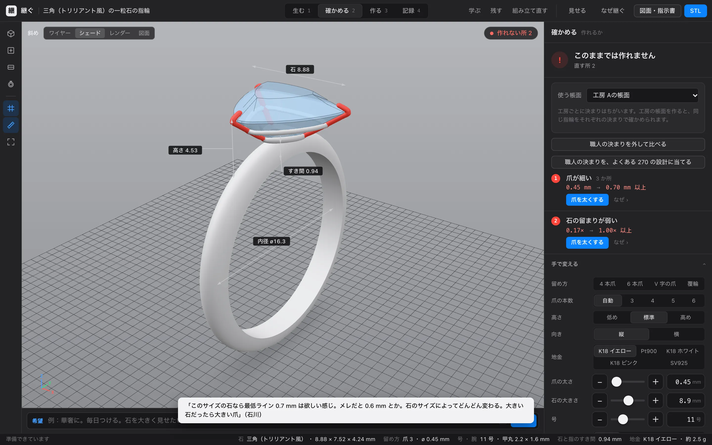
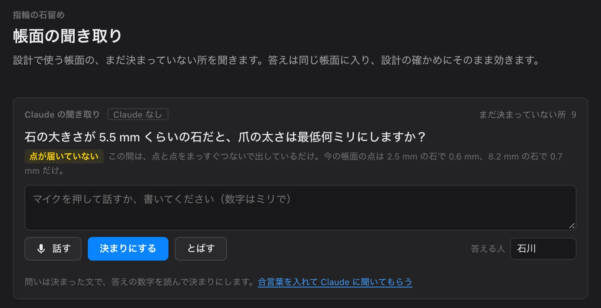
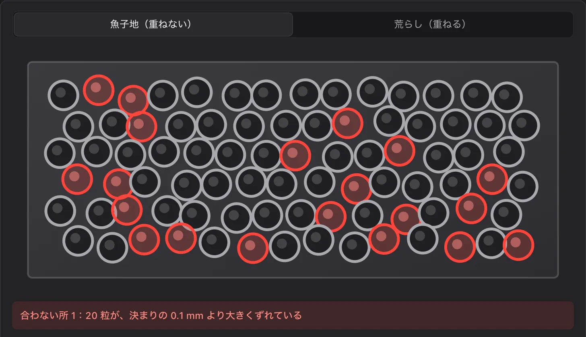

# 継ぐ（つぐ）

**職人の判断を、蓄える。失われた技まで、組み立て直す。**

彫金職人が、自分の仕事の判断を Claude に話して残し、その判断で、だれでも「本当に作れる」ジュエリーを一瞬で組めるようにした道具です。


**試す**：https://tsugu-craft.vercel.app/ （設計は [studio.html](https://tsugu-craft.vercel.app/studio.html)。Claude を使う所だけ合言葉が要ります。なくても、帳面の決まりで確かめ・作り方・学ぶまで動きます）

Built with Claude: Japan 2026（テーマ #1「あなたにしかない深さを。」）。作者は宝飾の彫金職人（石川）。

## なぜ作ったか

- **判断は、職人の頭の中にしかない。** 爪の太さ、石と指のすき間、どこにロウを流すか。ネットや本にあるのは一般の目安だけで、工房ごとの判断は残らない。
- **デザインと CAD の行き来。** イメージ → デザイン → CAD → 職人の間で「これは作れない」と何度も戻る。
- **教える人の手が止まる。** 学校では一人ずつ違う物を作ると先生の確認待ち、工房では教えるたびに先輩の手が止まる。
- **めったに作らない技ほど、途切れる。** 伝統的工芸品の従業員は 24 年で約 6 割減った（約 11.5 万人 → 約 4.8 万人。経済産業省の資料）。20 年に一度しか作らない技（たとえば式年遷宮の御装束神宝。その彫金・金工はジュエリーと同じ技）は、一人が一生で数えるほどしか関われない。

## できること

| | |
| --- | --- |
|  | **職人の一言で、形が変わる。** 話した言葉を Claude が帳面の決まりにし、その場で全部を確かめ直す（爪 1.66 mm → 0.80 mm）。 |
|  | **作れない所は赤く光る。** 押すと理由と直し方。ボタンで 1 つずつ、または Claude が指輪ぜんたいを読んでまとめて直す。職人の声で理由も聞ける。 |
|  | **だれでも、自由に作れる。** 石の写真 1 枚（白い紙の上で真上から）から組む。腕の断面は指で描く。石の大きさ・留め方・地金を選ぶ。石が腕に当たる所は自動でザグり、石座はロウ付けの形で腕につながる。 |
|  | **Claude が、職人に聞きに来る。** 帳面のまだ決まっていない所を、Claude が質問する。答えれば決まりになる。工房ごとに帳面を育てられる。 |
|  | **作り方と図面まで、その場で。** 鋳造・鍛造の工程、数字、道具。図面（正面・側面・上面と寸法）と STL。 |
|  | **ほかの技にも、途切れた技にも。** 木目金などの技の帳面。作り方が途切れた技は、残った手がかりから Claude が組み立て直し、隠しておいた本当の作り方と答え合わせする（11 工程のうち 9）。 |

数字は出典か職人の言葉から。出典のない数字は「仮」と書く。目安で、最後は職人が決める。

> 開発の記録（試行錯誤）は [docs/LOG.md](docs/LOG.md)、画面の構成は [docs/SCREENS.md](docs/SCREENS.md)、調べた資料は [docs/RESEARCH-rules2.md](docs/RESEARCH-rules2.md) ほか、職人の目安は [.claude/skills/jeweler-guides/SKILL.md](.claude/skills/jeweler-guides/SKILL.md)。

## MCP サーバー（Claude のアプリから使う）

職人がふだん使っている Claude のアプリ（Claude Desktop・Claude Code）から、継ぐの道具を直接使える。API キーは要らない（アプリの Claude が道具を呼ぶ）。

| 道具 | すること |
| --- | --- |
| `list_rules` | 目安帳を読む（出どころ・日付つき。置き換えた古い決まりも見られる） |
| `propose_rule` | 職人の決まりを目安帳に足す。同じ値の決まりは置き換え、古い決まりは履歴に残る。数字で確かめない手の決まりは、効く工程（steps）と一緒に残る |
| `check_ring` | 石と設計から指輪を組み、目安帳で確かめる。問題に「誰のどの決まりか」と直し方（見た目への影響つき）を添え、石の一番下と指のすき間・地金の重さも返す |
| `pattern_svg` | 原寸の型紙（A4 の SVG）を返す。`out/` に書き出すこともできる |

目安帳そのもの（`tsugu://ledger/jewelry`）と、会話の最初に目安帳を読み込むプロンプト（`ledger_context`）も出している。

**なぜ MCP か**：職人が目安帳を育てる場所と、設計を確かめる場所を、職人がもう使っている Claude のアプリにするため。画面と同じ関数・同じ決まりで確かめるので、どちらで確かめても答えが同じになる。目安帳はリポジトリの `ledger/jewelry.json` に書き込まれ、コミットすれば「誰がいつ何を変えたか」が git の履歴に残る（画面の目安帳はブラウザの中に残り、JSON で書き出し・読み込みできる）。

用意（最初の 1 回）：

```
npm install
npm run ledger:init   # ledger/jewelry.json を出発点の目安帳から作る（もうあれば何もしない）
```

Claude Code に足す（リポジトリのいちばん上で）：

```
claude mcp add tsugu -- "$PWD/node_modules/.bin/tsx" "$PWD/mcp/server.ts"
```

Claude Desktop に足す（設定の「開発者」→ 設定ファイル `claude_desktop_config.json` に。パスはリポジトリを置いた所に直す）：

```json
{
  "mcpServers": {
    "tsugu": {
      "command": "/path/to/tsugu-craft/node_modules/.bin/tsx",
      "args": ["/path/to/tsugu-craft/mcp/server.ts"]
    }
  }
}
```

- `npm run mcp` でも始まるが、npm が最初に出す行が MCP のやり取りに混ざるので、アプリの設定では上のように `tsx` を直接呼ぶ（`npm run --silent mcp` でもよい）。
- Claude Desktop が `node` を見つけられないとき（nvm などで入れたとき）は、`command` を node の絶対パス（`which node` で分かる）にし、`args` を `["/path/to/tsugu-craft/node_modules/tsx/dist/cli.mjs", "/path/to/tsugu-craft/mcp/server.ts"]` にする。
- 別の目安帳のファイルを使うときは、環境変数 `TSUGU_LEDGER` にそのパスを入れる。
- 試し方の例：「三角の石（長辺 8.88 mm、深さ 4.35 mm）で、爪を標準の 0.8 倍にした指輪を確かめて」「石の一番下は指から 1 mm 離す、という決まりを作者の名前で足して」。

## 開発の進め方（アカウント）

開発は作者の Claude アカウントで始め、そのアカウントのクレジットが切れたら、大会で配布されたアカウントに移って続ける。2 つのアカウントを同時には使わない。作ったもの・決めたこと・次にやることはすべてこのリポジトリ（`docs/NEXT.md` など）にあるので、移った後も同じ続きから進められる。移った日はここに書く。

- 移った日：（まだ）

## Claude の使い方

| 機能 | 何に使ったか | なぜ |
| --- | --- | --- |
| Claude Code | 開発の中心。仕様書と決まり（CLAUDE.md）を読み、作者と話しながら、画面・形の処理・写真の読み取り・確かめるルール・Claude とのつなぎ・MCP・手の記録を書いた。うまくいかなかったことと直し方を記録に残した | 職人の話をその場で仕様と動くものに変え、試行錯誤を回す速さのため |
| Skill | 職人の目安（`.claude/skills/jeweler-guides`） | 開発中の Claude もアプリの中の Claude も、同じ職人の目安を読むため |
| フック | API キーの混入を止める・形の処理を直したらテスト | 公開リポジトリにキーを入れないため。実際にテストの偽のキーで送信を止めた（LOG） |
| サブエージェント | Claude とのつなぎ・指輪の枠と確かめるルール・教える・MCP・手の記録・3D の作り直し・公開情報の調査を、別の作業フォルダで並行に作り、取り込んだ | 互いに触らない部品を同時に進め、一人（作者）の 6 日間で全体をそろえるため |
| MCP | 継ぐの道具（目安帳を読む・決まりを足す・組んで確かめる・型紙）を、Claude Desktop・Claude Code から使う（`mcp/`） | 職人がふだん使う Claude のアプリで目安帳を育て、設計を確かめられるように。画面と同じ関数・同じ決まりで動く |
| アプリの中の Claude | 指輪を道具で組み、帳面の決まりで確かめて直す（set_setting / set_shank / check / look。作業の記録を一行ずつ見せ、全部戻せる）・職人の話を決まりの案にする（propose_rule）・途切れた技を手がかりから組み立て、隠した答えと照らす（propose_process / grade_process）・学ぶ人の質問に帳面の理由で答え、答えられない質問を職人に回す（ask_teacher） | Claude は答えを決めるのではなく、職人の決まりを読んで選び、理由を残す役。道具の実行は画面の中、API キーはサーバーの関数だけが持つ。画面の前で待つ作業は考える量を少なくして速く返す |

## 使っているもの（ライセンス）

| 名前 | 用途 | ライセンス |
| --- | --- | --- |
| [three.js](https://github.com/mrdoob/three.js) | 3D の表示 | MIT |
| [Vite](https://github.com/vitejs/vite) | 開発用のサーバーと組み立て | MIT |
| [TypeScript](https://github.com/microsoft/TypeScript) | 言語 | Apache-2.0 |
| [Vitest](https://github.com/vitest-dev/vitest) | テスト | MIT |
| [Anthropic TypeScript SDK](https://github.com/anthropics/anthropic-sdk-typescript)（`@anthropic-ai/sdk`） | Claude API を呼ぶ（`api/claude.ts`）。画面は型だけ使う | Apache-2.0 |
| [@types/node](https://github.com/DefinitelyTyped/DefinitelyTyped) | serverless 関数（Node）の型 | MIT |
| [MCP TypeScript SDK](https://github.com/modelcontextprotocol/typescript-sdk)（`@modelcontextprotocol/sdk`） | MCP サーバー（`mcp/`）で、Claude のアプリに道具を出す | MIT |
| [Zod](https://github.com/colinhacks/zod) | MCP の道具の入力の形を決めて確かめる | MIT |
| [tsx](https://github.com/privatenumber/tsx) | MCP サーバーと目安帳を作る小さな処理を、TypeScript のまま動かす | MIT |
| [Playwright](https://github.com/microsoft/playwright) | デモ動画の素材を撮る（継ぐの画面を動かして録る・指輪を 1 こまずつ撮る。`video/`）。アプリには入らない | Apache-2.0 |
| [Kokoro-82M](https://huggingface.co/hexgrad/Kokoro-82M) と [kokoro-onnx](https://github.com/thewh1teagle/kokoro-onnx) | 仮の動画の声（人に近い機械の声、jm_kumo）。`video/tts_kokoro.py`。重みと声はリポジトリに入れない | Apache-2.0（重み）・MIT（kokoro-onnx） |
| [misaki](https://github.com/hexgrad/misaki) と [unidic-lite](https://github.com/polm/unidic-lite) | 声のための、日本語の読み方 | Apache-2.0・MIT（辞書は UniDic の BSD） |
| [MediaPipe Tasks Vision](https://github.com/google-ai-edge/mediapipe)（`@mediapipe/tasks-vision`） | 手の記録：動画から手の位置（21 点）をブラウザの中で読む。wasm はこのパッケージのものを一緒に配る | Apache-2.0 |
| [MediaPipe の手の点を読むモデル](https://ai.google.dev/edge/mediapipe/solutions/vision/hand_landmarker)（`hand_landmarker.task`、float16） | 手の記録で使うモデル。使うときに Google の配布先から読み込む（リポジトリには入れない） | Apache-2.0 |


画像を使うときは、ここに出典と利用条件を書き足す。

| 画像 | 出典 | 利用条件 |
| --- | --- | --- |
| `public/heritage/naiku-goshinpozu.jpg`（「内宮御神宝図」の一部を切り出して横につないだもの） | 国立国会図書館所蔵、[Wikimedia Commons](https://commons.wikimedia.org/wiki/File:NDL2574228_%E5%86%85%E5%AE%AE%E5%BE%A1%E7%A5%9E%E5%AE%9D%E5%9B%B3.(1).pdf) | パブリックドメイン |
| `public/heritage/tsuba-carp.jpg`（鯉と藻の鐔） | メトロポリタン美術館、[Wikimedia Commons](https://commons.wikimedia.org/wiki/File:%E8%97%BB%E9%AF%89%E5%9B%B3%E9%90%94,_Sword_Guard_(Tsuba)_with_the_Carp_and_Seaweed_Motif.jpg) | CC0 |
| `public/heritage/kazari-tachi.jpg`（飾太刀、平安時代。一部を切り出し） | 東京国立博物館、[ColBase](https://colbase.nich.go.jp/collection_items/tnm/F-356)・[Wikimedia Commons](https://commons.wikimedia.org/wiki/File:Kazari-tachi_Style_Sword_Mounting,_Heian_period.jpg) | CC BY 4.0 |
| `public/heritage/tachi.jpg`（太刀と拵え） | メトロポリタン美術館、[Wikimedia Commons](https://commons.wikimedia.org/wiki/File:Blade_and_Mounting_for_a_Slung_Sword_(Tachi)_MET_1820.jpg) | CC0 |
| `public/heritage/naiku-1953.jpg`（1953 年の内宮の空からの写真） | 本田照夫 撮影、[Wikimedia Commons](https://commons.wikimedia.org/wiki/File:Ise_Shrine_Naiku_1953-8-26_cropped.jpg) | パブリックドメイン |
| `public/lp/*.webp`（入口のページの写真：hero・hero-phone・before・after・thin・c-stone5・c-stone10・c-hira・c-free・c-bezel・c-pt・ask・make・draw・nanako と、それぞれ半分の幅の `-sm`） | 継ぐの画面を撮ったもの（`scripts/lp-shots.cjs`） | このリポジトリの作品の一部 |

`samples/triangle_closeup_2026-11-02.jpg` と、同じ写真の `public/stones/triangle.jpg` は作者が撮った写真（撮影情報は消してある）。

## ライセンス

（大会の運営に確認してから決める）
