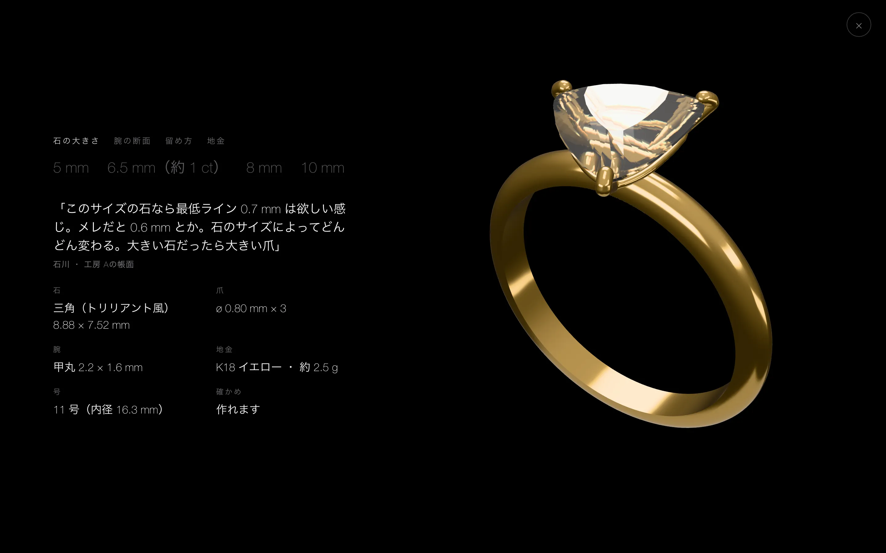
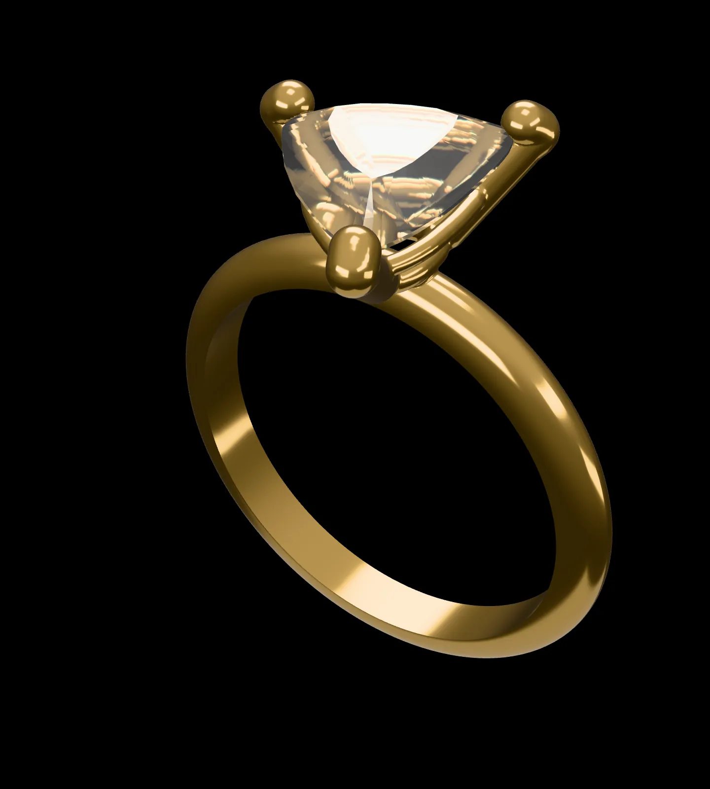
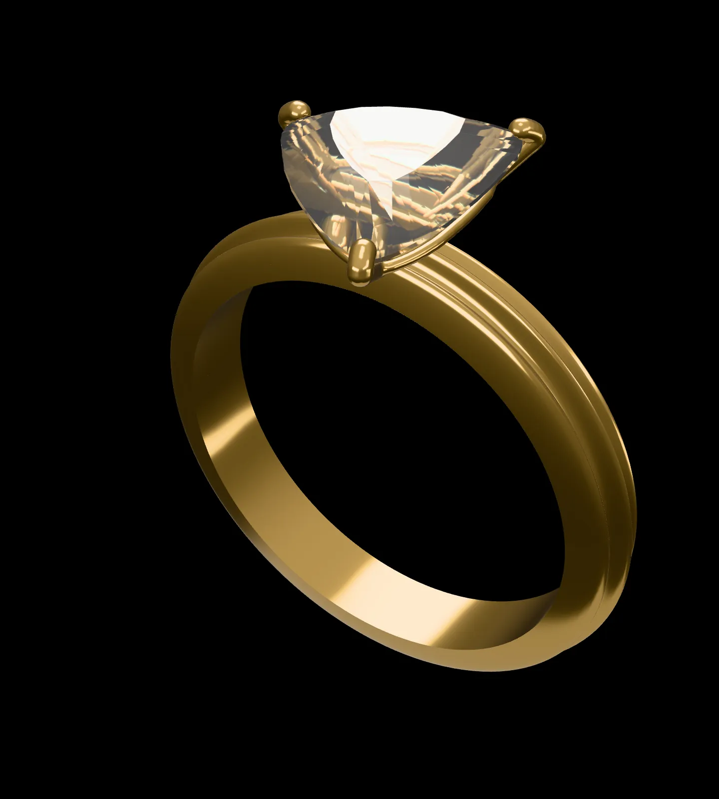
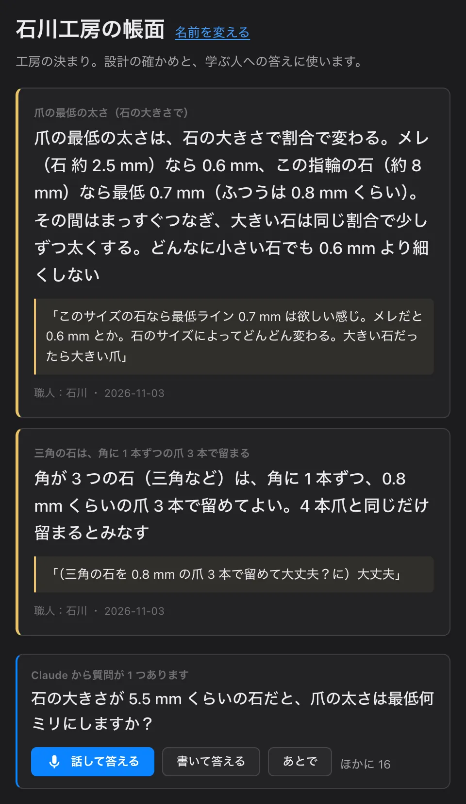
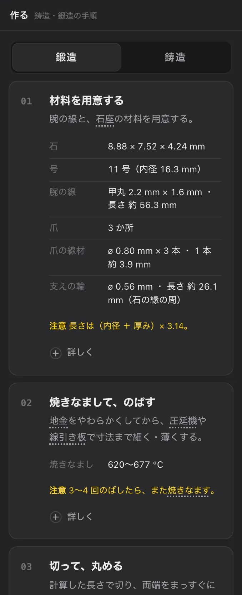
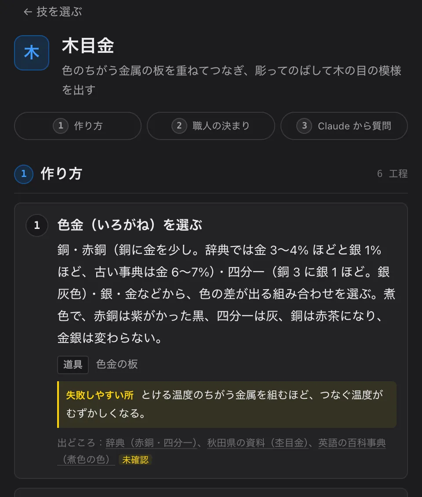

# 継ぐ（つぐ）

**職人の判断を、蓄える。失われた技まで、組み立て直す。**

彫金職人が、自分の仕事の判断を Claude に話して残し、その判断で、だれでも「本当に作れる」ジュエリーを一瞬で組めるようにした道具です。



**試す**：https://tsugu-craft.vercel.app/ （設計は [studio.html](https://tsugu-craft.vercel.app/studio.html)。Claude を使う所だけ合言葉が要ります。なくても、帳面の決まりで確かめ・作り方・学ぶまで動きます）

Built with Claude: Japan 2026（テーマ #1「あなたにしかない深さを。」）。作者は宝飾の彫金職人（石川）。

## なぜ作ったか

- **判断は、職人の頭の中にしかない。** 爪の太さ、石の先と指の間、どこにロウを流すか。ネットや本にあるのは一般の目安だけで、工房ごとの判断は残らない。
- **デザインと CAD の行き来。** イメージ → デザイン → CAD → 職人の間で「これは作れない」と何度も戻る。
- **教える人の手が止まる。** 学校では一人ずつ違う物を作ると先生の確認待ち、工房では教えるたびに先輩の手が止まる。
- **めったに作らない技ほど、途切れる。** 伝統的工芸品の従業員は 24 年で約 6 割減った（約 11.5 万人 → 約 4.8 万人。経済産業省の資料）。20 年に一度しか作らない技（たとえば式年遷宮の御装束神宝。その彫金・金工はジュエリーと同じ技）は、一人が一生で数えるほどしか関われない。

## できること

| | |
| --- | --- |
|  | **職人の一言で、形が変わる。** 話した言葉を Claude が帳面の決まりにし、その場で全部を確かめ直す（爪 1.66 mm → 0.80 mm）。 |
|  | **作れない所は赤く光る。** 押すと理由と直し方。ボタンで 1 つずつ、または Claude が指輪ぜんたいを読んでまとめて直す。職人の声で理由も聞ける。 |
|  | **だれでも、自由に作れる。** 石の写真 1 枚（白い紙の上で真上から）から組む。腕の断面は指で描く。石の大きさ・留め方・地金を選ぶ。石が腕に当たる所は自動でザグり、石座はロウ付けの形で腕につながる。 |
|  | **Claude が、職人に聞きに来る。** 帳面のまだ決まっていない所を、Claude が質問する。答えれば決まりになる。工房ごとに帳面を育てられる。 |
|  | **作り方と図面まで、その場で。** 鋳造・鍛造の工程、数字、道具。図面（正面・側面・上面と寸法）と STL。 |
|  | **ほかの技にも、途切れた技にも。** 木目金などの技の帳面。作り方が途切れた技は、残った手がかりから Claude が組み立て直し、隠しておいた本当の作り方と答え合わせする（11 工程のうち 9）。 |

数字は出典か職人の言葉から。出典のない数字は「仮」と書く。目安で、最後は職人が決める。

> 開発の記録（試行錯誤）は [docs/LOG.md](docs/LOG.md)、画面の構成は [docs/SCREENS.md](docs/SCREENS.md)、調べた資料は [docs/RESEARCH-rules2.md](docs/RESEARCH-rules2.md) ほか、職人の目安は [.claude/skills/jeweler-guides/SKILL.md](.claude/skills/jeweler-guides/SKILL.md)。

## 使い方

入口のページ（`/`）から「はじめる」で設計へ。どの画面も、PC とスマホの縦画面で動きます。

### 設計（`studio.html`）

上のタブ（1〜4 のキーでも）で 4 つの場面を行き来します。3D の左上で「ワイヤー／シェード／レンダー／図面」、左で見る向き（斜め・正面・横・上）・方眼・寸法を選びます。正面・横・上は、パースのない平らな図になり、回せません（数値を確かめるための図）。

1. **生む**：作る物（一粒石の指輪／甲丸・平打ちの指輪）を選び、石を決める。石は写真（白い紙の上で真上から。長辺と深さだけ測って入れる。撮り方は「？」）か、よくある形。希望の言葉（例：細めで、手のひら側を薄く）を書いて「生む」を押すと、Claude が道具で組み、作れるか確かめて直す。作業の記録が一行ずつ出て、全部戻せる。
2. **確かめる**：作れない所が 3D で赤く点滅する。
   - **作れない所の窓**：赤い所か札を押すと、どこが・なぜ（誰のどの決まりか）・直し方が出る。直し方のボタンで 1 つずつ、「まとめて直す」で全部、「Claude で直す」で Claude が指輪ぜんたいを読んで直す。原因の欄は赤くなる。「▶ 職人の声で聞く」で理由を声で聞ける。
   - **手で変える**：石の大きさのつまみ（同じ形のまま大きく・小さく。爪の太さは帳面の決まりで決め直す）、留め方（4 本爪・6 本爪・覆輪）、爪の太さ、高さ、向き、号、地金。
   - **断面を描く**：腕の断面を、甲丸・平打ち・半甲丸・角から選ぶか、指で描く。点を動かす・足す・消す、左右対称、自由に描く（なめらかな線に直る）、元に戻す。尖りすぎた先や薄いヒレだけが赤くなる。
   - **ザグり・ロウ付けのつなぎ目**：石の先が腕の厚みの中まで下りるときは、腕の上を丸いビットで削ったくぼみを自動で作る（深さと直径を出す）。石座は 1 つの部品で、下の輪が腕を横切る 2 か所に座とロウの丸みを作って腕につなぐ。3D・図面・重さ・STL がみな同じ形。
   - **職人の決まり**：話す（Claude が決まりの案にする）か、Claude なしで数字で書く →「これでいい」で、今の設計とこれまでの作品をすべて確かめ直し、まとめて直す。「職人の決まりを外して比べる」で、公開情報だけで組んだ形（爪 1.66 mm）と並べられる。工房ごとに帳面を作り、同じ指輪を帳面ごとに比べられる。
3. **作る**：鋳造／鍛造の工程の札。数字・道具・「詳しく」、言葉を押すとその場で意味。工程の中に、職人の手の決まりと、前の記録のコツ（「前の記録から」）。**図面**（正面・側面・上面と寸法・表題欄、A4 横）・作り方・原寸の型紙の印刷と、**STL** の書き出し。
4. **記録**：作った物ごとの記録（形・作れるか・作り方・職人のひとこと。話すと Claude が工程ごとのコツに分ける）。新しい決まりで直した跡。記録の帳面の印刷。記録が空なら、見本の作品を入れて試せる（職人の作品ではないと名前に出る）。

**見せる** を押すと、全画面の黒の上で指輪が回り、本物の数字と職人の言葉が出ます。石の大きさ・腕の断面・留め方・地金を押して切り替えられます。

### 帳面・学ぶ・技（`app.html`）

下のタブは 設計・帳面・学ぶ・技 の 4 つ。

- **帳面**（`#ledger`）：いちばん上に職人の決まりの札（決まり・職人の言葉・名前と日・見せた動画）。その下に「Claude から質問が 1 つあります」：帳面のまだ決まっていない所を Claude が聞き、話すか書いて答えると決まりの案になり、「これでいい」で帳面に入る。公開の資料から入れた目安は、出どころのリンクつきで別に並ぶ。帳面の印刷・手本を撮る・思いついたことを話して残す・工房の名前を変える。
- **学ぶ**（`#learn`）：「職人に聞く」。言葉で聞くと、帳面の決まりから理由つきで答え、「なぜ？」で職人の言葉まで戻れる。帳面に答えがないことは、職人への質問として帳面に届く。合言葉がなくても、帳面から探して答える（「Claude なし」と出る）。「手の動きで比べる」（`#learn/hands`）は、手本の動画と自分の動画の手の動きを比べる 2 つ目の入口。
- **技**（`#waza`）：指輪の石留め・覆輪留め・ミル打ち・槌目・鏨彫り・布目象嵌・木目金。どの技も同じ形のページ（① 作り方 → ② 職人の決まり → ③ Claude から質問）。指輪の石留めは「設計で試す」で設計へ。**途切れた技を、手がかりから組み立て直す（木目金）**。
  - **組み立て直す**（`#waza/rebuild`）：作り方を隠した木目金について、残った品物・断面の層・金属・時代・道具の手がかり（`research/mokume/clues.md`）だけを Claude に渡し、工程を組み立てさせる。そのあと、隠しておいた本当の作り方（`research/mokume/answer.md`）と答え合わせする（11 工程のうち 9 が一致）。Claude がもともと覚えていたかもしれない工程は、どの手がかりも引いていないものとして分けて数える。

### 合言葉がないとき

Claude を使う所（希望の言葉から生む・話した決まり・Claude で直す・Claude の質問の答えを決まりにする・組み立て直す）は合言葉が要ります。それ以外は合言葉なしで全部動きます。山場の「職人の一言」は「Claude なしで、数字で書く」と見本の作品で試せます。帳面の質問は、合言葉がなければ決まった問いと数字を読むしくみで動きます。

## だれの判断か（職人・公開の資料・仮）

継ぐの決まりは、出どころを 3 つに分けて持ち、画面にも出しています。

| 出どころ | 中身 | どこに |
| --- | --- | --- |
| **職人（作者・石川）** | 爪の最低の太さ（メレ 約 2.5 mm で 0.6 mm、約 8 mm の石で 0.7 mm。石の大きさに合わせて線でつなぐ）／三角の石は角に 1 本ずつの爪 3 本で留まる／石座は 1 つの部品で腕にのせてロウ付けする（爪を 1 本ずつ腕へささらせない）／ロウですき間を埋めようとせず、継ぎ目をぴったり合わせてから最後にロウでつなぐ／石の先が当たる所はザグる／断面で危ないのはとがった先や薄いヒレだけ、など | `ledger/jewelry.json`（「職人：石川」）、`.claude/skills/jeweler-guides/SKILL.md` |
| **職人の直し（作者が触って言ったこと）** | 「すき間 0.94 が何か分からない」→ 寸法の名前を「石の先〜指」「指から上」に／正面・横・上はパースのない図に／ザグりが雑 → 球のビットの丸いくぼみに／どうロウ付けしているか分からない → 座とロウの丸み／四角い石に 6 本爪は不自然 → 注意を出す／V 字の爪を外す、など | `docs/LOG.md`（日付つき。「作者の声」「作者の頼み」） |
| **公開の資料** | 指輪の決まり 34 と、六つの技の決まり 42（覆輪の壁の厚み、爪の先の高さ、号数と内径、地金の温度など）。どれも出どころの URL つき。原文を開けなかったものは「未確認」 | `ledger/ring-public.json`・`ledger/techniques.json`、`docs/RESEARCH-rules2.md` ほか |
| **仮** | 出どころの数字が見つからない値（石の先を指から 0.3 mm、角から 0.9 mm、爪の間 38%、ザグりの縁の丸み、石を並べる間など）。画面にも「仮の目安」と出す。職人が決めると置き換わる | `src/rules/guides.ts`、Skill に「**仮の目安**」 |

数字は出典か職人の言葉から。出典のない数字は「仮」と書きます。どれも目安で、最後は職人が決めます。

## MCP サーバー（Claude のアプリから使う）

職人がふだん使っている Claude のアプリ（Claude Desktop・Claude Code）から、継ぐの道具を直接使える。API キーは要らない（アプリの Claude が道具を呼ぶ）。

| 道具 | すること |
| --- | --- |
| `list_rules` | 目安帳を読む（出どころ・日付つき。置き換えた古い決まりも見られる） |
| `propose_rule` | 職人の決まりを目安帳に足す。同じ値の決まりは置き換え、古い決まりは履歴に残る。数字で確かめない手の決まりは、効く工程（steps）と一緒に残る |
| `check_ring` | 石と設計から指輪を組み、目安帳で確かめる。問題に「誰のどの決まりか」と直し方（見た目への影響つき）を添え、石の先〜指（石の一番下と指の間）・地金の重さ・石の留まりも返す |
| `pattern_svg` | 原寸の型紙（A4 の SVG）を返す。`out/` に書き出すこともできる |

目安帳そのもの（`tsugu://ledger/jewelry`）と、会話の最初に目安帳を読み込むプロンプト（`ledger_context`）も出している。

**なぜ MCP か**：職人が目安帳を育てる場所と、設計を確かめる場所を、職人がもう使っている Claude のアプリにするため。画面と同じ関数・同じ決まりで確かめるので、どちらで確かめても答えが同じになる。目安帳はリポジトリの `ledger/jewelry.json` に書き込まれ、コミットすれば「誰がいつ何を変えたか」が git の履歴に残る（画面の帳面は、使う人のブラウザの中に残る）。

用意（最初の 1 回）：

```
npm install
npm run ledger:init   # ledger/jewelry.json を出発点の目安帳から作る（もうあれば何もしない）
```

Claude Code に足す（リポジトリのいちばん上で）：

```
claude mcp add tsugu -- "$PWD/node_modules/.bin/tsx" "$PWD/mcp/server.ts"
```

Claude Desktop に足す（設定の「開発者」→ 設定ファイル `claude_desktop_config.json` に。パスはリポジトリを置いた所に直す）：

```json
{
  "mcpServers": {
    "tsugu": {
      "command": "/path/to/tsugu-craft/node_modules/.bin/tsx",
      "args": ["/path/to/tsugu-craft/mcp/server.ts"]
    }
  }
}
```

- `npm run mcp` でも始まるが、npm が最初に出す行が MCP のやり取りに混ざるので、アプリの設定では上のように `tsx` を直接呼ぶ（`npm run --silent mcp` でもよい）。
- Claude Desktop が `node` を見つけられないとき（nvm などで入れたとき）は、`command` を node の絶対パス（`which node` で分かる）にし、`args` を `["/path/to/tsugu-craft/node_modules/tsx/dist/cli.mjs", "/path/to/tsugu-craft/mcp/server.ts"]` にする。
- 別の目安帳のファイルを使うときは、環境変数 `TSUGU_LEDGER` にそのパスを入れる。
- 試し方の例：「三角の石（長辺 8.88 mm、深さ 4.35 mm）で、爪を標準の 0.8 倍にした指輪を確かめて」「石の一番下は指から 1 mm 離す、という決まりを作者の名前で足して」。


## Claude の使い方

作者（彫金職人）が Claude Code に話しかけて作りました。作者が話す → Claude Code が仕様と決まり（`CLAUDE.md`・`docs/SPEC.md`）に照らして作る → ヘッドレスのブラウザで撮って確かめる → 作者が iPhone で触って直してほしい所を言う、をくり返しました。その声と直し方は `docs/LOG.md` に日付つきで残っています。

| 機能 | 何に使ったか | なぜ |
| --- | --- | --- |
| **Claude Code** | 開発の中心。画面・形の処理（石・石座・腕・ザグり・ロウのつなぎ目・断面の線）・写真の読み取り・確かめるルール・Claude とのつなぎ・MCP・手の記録・デモ動画を組む仕組みまで、すべてこのリポジトリで書いた。うまくいかなかったことと直し方を LOG に残した | 職人の話を、その場で仕様と動くものに変え、試行錯誤を速く回すため |
| **サブエージェント（別の作業フォルダ）** | 大きな機能を、`.claude/worktrees/` の別の作業フォルダで並行に作り、確かめてから作業ブランチに取り込んだ（例：正面・横・上の平らな図、画面を 4 つのタブに、腕の断面の線、ザグり、ザグりの丸いくぼみとロウのつなぎ目、石を並べる指輪、帳面を大きくする、動画の最終案）。公開の資料の調べ、全部のボタンを押して確かめる係も別のエージェントに頼んだ | 互いに触らない部品を同時に進め、一人（作者）の 6 日間で全体をそろえるため。作業フォルダを分けると、途中の物がほかの作業を壊さない |
| **Skill** | 職人の目安（`.claude/skills/jeweler-guides/SKILL.md`）。値・出どころ・「仮」を 1 か所に書き、`src/rules/` の設定と合わせて直す | 開発中の Claude も、アプリの中の Claude も、同じ職人の目安を読むため |
| **フック** | コマンドの前に API キーの混入を止める（`scripts/hooks/check-secrets.mjs`）。ファイルを直したら、形の処理と確かめるルールのテストを自動で回す（`scripts/hooks/run-tests.mjs`） | 公開リポジトリにキーを入れないため（テストの偽のキーで送信を止めたことがある。LOG）。形を壊したらすぐ分かるため |
| **MCP** | 継ぐの道具（目安帳を読む・決まりを足す・組んで確かめる・型紙）を Claude Desktop・Claude Code から使う（`mcp/`） | 職人がふだん使う Claude のアプリで帳面を育て、設計を確かめられるように。画面と同じ関数・同じ決まりで動く |
| **アプリの中の Claude**（Claude API、`api/claude.ts`） | 下の表の道具を、画面の中で Claude に使わせる | Claude は答えを決めるのではなく、職人の決まりを読んで選び、理由を残す役。寸法と確かめはプログラムの計算で、いつも同じ答え |

アプリの中の Claude の道具（実行は画面の中。API キーはサーバーの関数だけが持つ）：

| 道具 | どこで | すること |
| --- | --- | --- |
| `set_setting`・`set_shank`・`check`・`look` | 設計の「生む」「Claude で直す」 | 石座（留め方・爪・高さ・向き）と腕（断面・幅・厚み・号・地金）を変え、帳面で確かめ、見た目を見て、作れない所を直す。作業の記録を一行ずつ出し、全部戻せる |
| `set_stones` | 石を並べる指輪（いまは画面から外している） | 三石・横一列の石の並びと間を決める |
| `propose_rule` | 設計の「職人の決まり」・帳面の「話して残す」 | 職人の話を決まりの案（題・言葉・理由・数字・職人の言葉そのまま）にする。決めるのは職人（「これでいい」） |
| `ask_gap`・`gap_rule` | 帳面の「Claude から質問」・技の帳面 | 帳面のまだ決まっていない所を Claude が選んで聞き、職人の答えを決まりの案にする |
| `ask_teacher` | 学ぶの「職人に聞く」 | 帳面の決まりで理由つきで答える。答えられないことは職人への質問に回す |
| `red_pen` | 学ぶの「手の動きで比べる」 | 手本と学ぶ人の同じ瞬間の画像を見比べ、赤ペンの印とひとことを付ける |
| `propose_process`・`grade_process` | 技の「組み立て直す」 | 手がかりから工程を組み立て（どの手がかりを引いたかつき）、隠した答えと照らして採点する |

画面の前で待つ作業は、考える量を少なくして速く返します。

## 開発の進め方（アカウント）

開発は作者の Claude アカウントで始め、そのアカウントのクレジットが切れたら、大会で配布されたアカウントに移って続けます。2 つのアカウントを同時には使いません。作ったもの・決めたこと・次にやることは、すべてこのリポジトリ（`docs/NEXT.md`・`docs/LOG.md`）にあるので、移った後も同じ続きから進められます。移った日はここに書きます。

- 移った日：（まだ）

## 使っているもの（ライセンス）

アプリに入るもの（`package.json` の dependencies）：

| 名前 | 用途 | ライセンス |
| --- | --- | --- |
| [three.js](https://github.com/mrdoob/three.js)（`three`） | 3D の表示 | MIT |
| [Anthropic TypeScript SDK](https://github.com/anthropics/anthropic-sdk-typescript)（`@anthropic-ai/sdk`） | Claude API を呼ぶ（`api/claude.ts`）。画面は型だけ使う | Apache-2.0 |
| [MCP TypeScript SDK](https://github.com/modelcontextprotocol/typescript-sdk)（`@modelcontextprotocol/sdk`） | MCP サーバー（`mcp/`） | MIT |
| [Zod](https://github.com/colinhacks/zod)（`zod`） | MCP の道具の入力の形を決めて確かめる | MIT |
| [MediaPipe Tasks Vision](https://github.com/google-ai-edge/mediapipe)（`@mediapipe/tasks-vision`） | 手の記録：動画から手の位置（21 点）をブラウザの中で読む。wasm はこのパッケージのものを一緒に配る | Apache-2.0 |
| [MediaPipe の手の点を読むモデル](https://ai.google.dev/edge/mediapipe/solutions/vision/hand_landmarker)（`hand_landmarker.task`、float16） | 手の記録で使うモデル。使うときに配布先から読み込む（リポジトリには入れない） | Apache-2.0 |

開発のときだけ使うもの（devDependencies。アプリには入らない）：

| 名前 | 用途 | ライセンス |
| --- | --- | --- |
| [TypeScript](https://github.com/microsoft/TypeScript) | 言語 | Apache-2.0 |
| [Vite](https://github.com/vitejs/vite) | 開発用のサーバーと組み立て | MIT |
| [Vitest](https://github.com/vitest-dev/vitest) | テスト（`npm test`） | MIT |
| [tsx](https://github.com/privatenumber/tsx) | MCP サーバーと目安帳を作る処理を、TypeScript のまま動かす | MIT |
| [@types/node](https://github.com/DefinitelyTyped/DefinitelyTyped)・[@types/three](https://github.com/DefinitelyTyped/DefinitelyTyped) | 型 | MIT |
| [Playwright](https://github.com/microsoft/playwright) | ヘッドレスのブラウザで画面を撮って確かめる・入口のページの写真（`scripts/lp-shots.cjs`）・デモ動画の素材（`video/`） | Apache-2.0 |

デモ動画を組むときだけ使うもの（作者の Mac の作業用の環境だけ。リポジトリにもアプリにも入れない・配らない）：

| 名前 | 用途 | ライセンス |
| --- | --- | --- |
| [Pillow](https://github.com/python-pillow/Pillow)・[NumPy](https://github.com/numpy/numpy) | こまを組む・音楽と効果音を作る（`video/reel.py`・`bgm*.py`・`sfx.py`） | MIT-CMU（HPND）・BSD-3-Clause |
| [FFmpeg](https://ffmpeg.org/) | こまと音を動画にする（外のコマンドとして呼ぶ） | LGPL-2.1 以降（入れ方により GPL） |
| [Kokoro-82M](https://huggingface.co/hexgrad/Kokoro-82M)・[kokoro-onnx](https://github.com/thewh1teagle/kokoro-onnx)・[soundfile](https://github.com/bastibe/python-soundfile) | **仮の声だけ**（作者の声が届くまでの機械の声、`video/tts_kokoro.py`）。重みと声はリポジトリに入れない。作者の声に替えたら使わない | Apache-2.0（重み）・MIT・BSD-3-Clause |
| [misaki](https://github.com/hexgrad/misaki)・[unidic-lite](https://github.com/polm/unidic-lite) | 仮の声のための日本語の読み方 | Apache-2.0・MIT（辞書は UniDic の BSD） |
| [pyopenjtalk](https://github.com/r9y9/pyopenjtalk) | 前の仮の動画の確かめ用の声（`video/tts.py`） | MIT |

- 音楽と効果音は、すべて自作（`video/bgm*.py`・`video/sfx.py` が音を計算で作る）。外の曲や効果音の素材は使っていない。
- 字は、使う人の端末にもとからある字（ヒラギノ・游ゴシックなど）を名前で呼ぶだけ。字のファイルは配らない。動画の字も、作者の Mac にもとからあるヒラギノ角ゴシック・ヒラギノ明朝。

画像：

| 画像 | 出典 | 利用条件 |
| --- | --- | --- |
| `public/heritage/naiku-goshinpozu.jpg`（「内宮御神宝図」の一部を切り出して横につないだもの） | 国立国会図書館所蔵、[Wikimedia Commons](https://commons.wikimedia.org/wiki/File:NDL2574228_%E5%86%85%E5%AE%AE%E5%BE%A1%E7%A5%9E%E5%AE%9D%E5%9B%B3.(1).pdf) | パブリックドメイン |
| `public/heritage/tsuba-carp.jpg`（鯉と藻の鐔） | メトロポリタン美術館、[Wikimedia Commons](https://commons.wikimedia.org/wiki/File:%E8%97%BB%E9%AF%89%E5%9B%B3%E9%90%94,_Sword_Guard_(Tsuba)_with_the_Carp_and_Seaweed_Motif.jpg) | CC0 |
| `public/heritage/kazari-tachi.jpg`（飾太刀、平安時代。一部を切り出し） | 東京国立博物館、[ColBase](https://colbase.nich.go.jp/collection_items/tnm/F-356)・[Wikimedia Commons](https://commons.wikimedia.org/wiki/File:Kazari-tachi_Style_Sword_Mounting,_Heian_period.jpg) | CC BY 4.0 |
| `public/heritage/tachi.jpg`（太刀と拵え） | メトロポリタン美術館、[Wikimedia Commons](https://commons.wikimedia.org/wiki/File:Blade_and_Mounting_for_a_Slung_Sword_(Tachi)_MET_1820.jpg) | CC0 |
| `public/heritage/naiku-1953.jpg`（1953 年の内宮の空からの写真） | 本田照夫 撮影、[Wikimedia Commons](https://commons.wikimedia.org/wiki/File:Ise_Shrine_Naiku_1953-8-26_cropped.jpg) | パブリックドメイン |
| `public/lp/*.webp`（入口のページと README の写真：hero・hero-phone・before・after・fixpop・spike・zaguri・trio-round・trio-pear・c-stone5・c-stone10・c-hira・c-free・c-bezel・c-pt・ledger・ledger-pub・waza・tech・rebuild・make・draw と、それぞれ半分の幅の `-sm`） | 継ぐの画面を撮ったもの（`scripts/lp-shots.cjs`） | このリポジトリの作品の一部 |
| `samples/triangle_closeup_2026-11-02.jpg`・`public/stones/triangle.jpg`（同じ写真） | 作者が撮った石の写真（撮影情報は消してある） | このリポジトリの作品の一部 |

## ライセンス

（大会の運営に確認してから決める）
