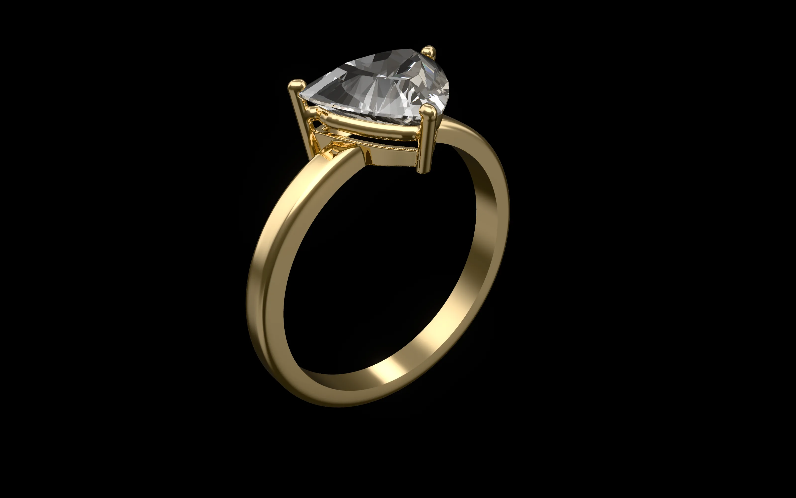
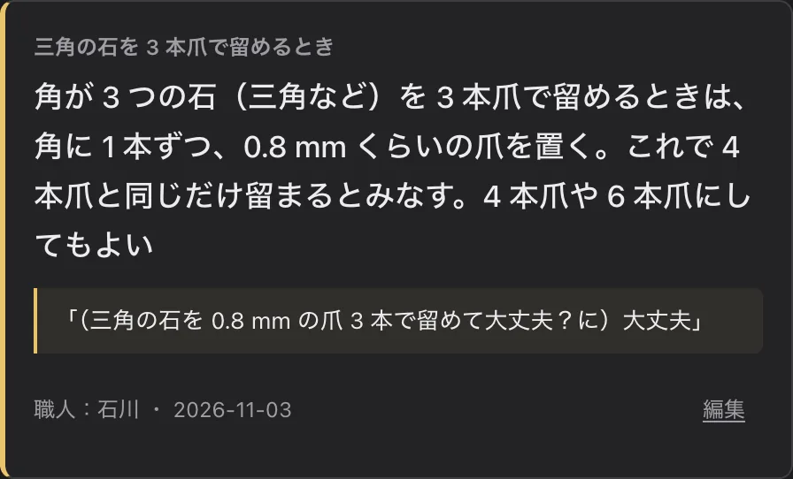
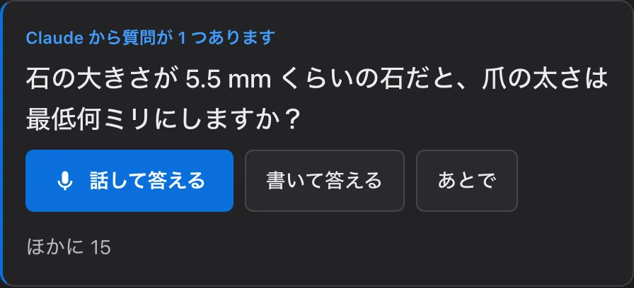
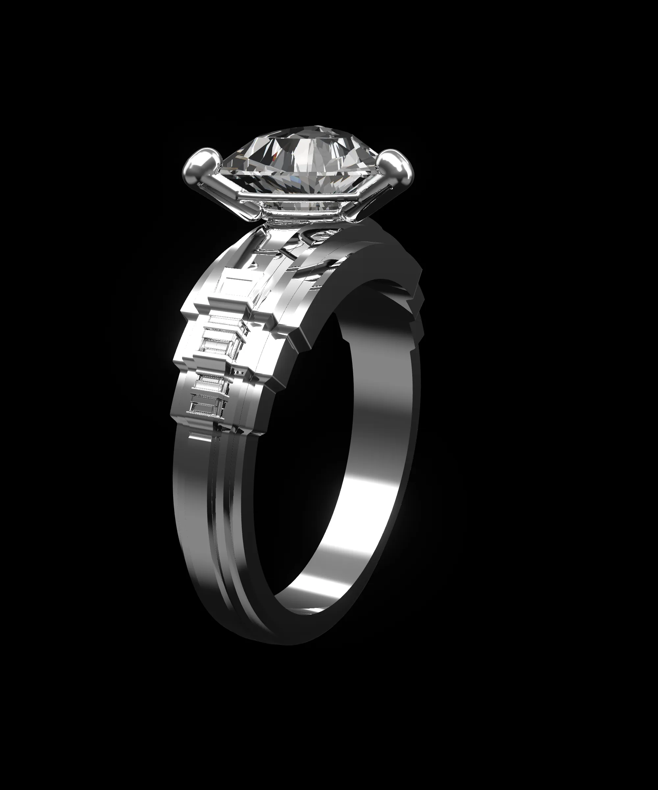
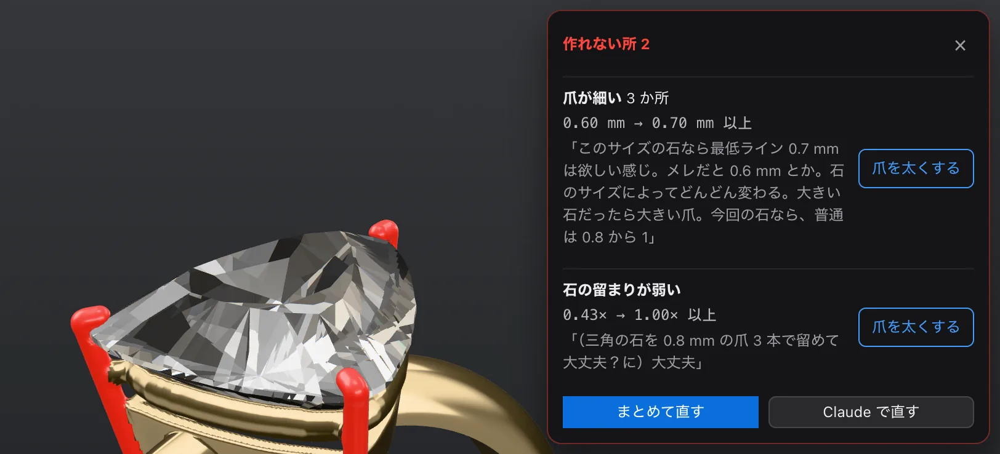
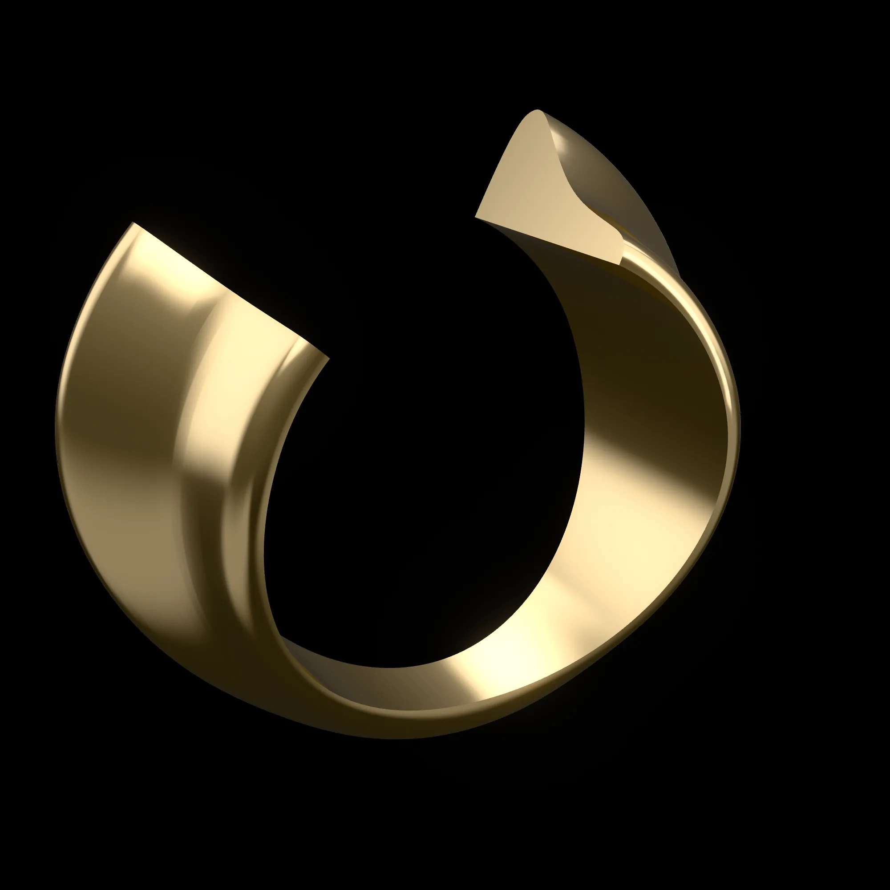
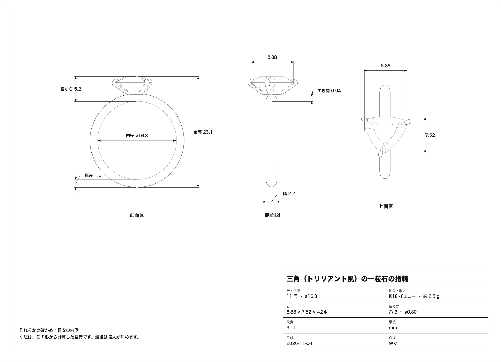
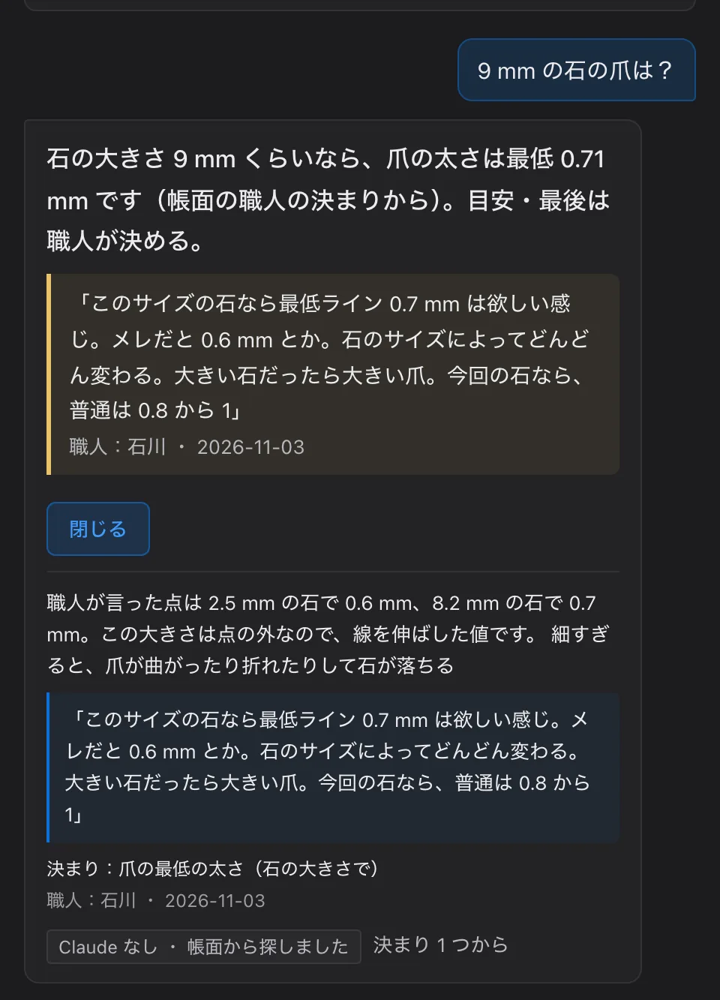

# 継ぐ（つぐ）

**職人の判断を、蓄える。失われた技まで、組み立て直す。**

宝飾の職人が、Claude Code と作った道具です。職人の頭の中にしかない判断を、Claude が聞き取って工房の帳面に残し、デザインする人・設計する人・学ぶ人・次の世代が理由つきで使えるようにします。迷う時間を、作る時間に。作り方が途切れた技も、手がかりと帳面から組み立て直し、出来上がりをシミュレーションして再現を試せます。

[](https://youtu.be/vPZL_vgXlNs)

▶ **デモ動画（3 分）**：[継ぐ — 職人の判断を、次の人へ｜Built with Claude: Japan 2026](https://youtu.be/vPZL_vgXlNs)

▶ **使ってみる**：https://tsugu-craft.vercel.app/
- [設計](https://tsugu-craft.vercel.app/studio.html)：石と希望の言葉から指輪を組み、職人の帳面で「作れるか」を確かめ、図面・作り方・STL まで出す
- [技の再現](https://tsugu-craft.vercel.app/app.html#waza/restore)：途切れた技（ダマスカス鋼など）の作り方を手がかりから組み立て、模様をシミュレーションする
- [見本](https://tsugu-craft.vercel.app/app.html?mihon#waza/kebori)：Claude を呼ばずに、職人が残す → 学ぶ人が受け取る流れを最後まで見る

公開の頁は、合言葉なしで使えます。Claude が考えて答える所（言葉で頼む生成・Claude に教える・職人に聞く・技の再現の案）だけは、API の使いすぎを防ぐため合言葉で守っています。自分のパソコンで動かすときは、自分の API キーを `.env` に入れれば、合言葉なしで全部使えます（下の「自分のパソコンで動かす」）。

Built with Claude: Japan 2026（テーマ #1「あなたにしかない深さを。」）。作者は宝飾の職人（石川）。

## なぜ作ったか

- **判断は、職人の頭の中にしかない。** 爪の太さ、石の先と指の間、どこにロウを流すか。ネットや本にあるのは一般の目安だけで、工房ごとの判断は残らない。
- **デザインと制作の行き来。** デザインの絵が「これは作れない」と、制作から何度も戻ってくる。
- **教える人の手が止まる。** 学校では一人ずつ違う物を作ると、先生の確認を待つ（作者の経験では、長いときは 1 時間）。工房では、教えるたびに先輩の手が止まる。
- **めったに作らない技ほど、途切れる。** 国が指定した伝統的工芸品の従業員は、24 年で約 6 割減った（約 11.5 万人 → 約 4.8 万人。経済産業省の説明資料）。何年もかけて作り、20 年に一度しか作り直さない技（公に知られた例では、伊勢神宮の式年遷宮の御装束神宝）には、多い人でも一生に 3 回ほどしか関われない（国土交通白書。社殿の技能者の話）。

## 継ぐですること

職人の言葉を**残す**。それを 3 つの相手へ**渡す**：デザインする人、学ぶ人、次の時代。

### 残す（職人）

1. 職人が、ふだんの話し言葉で話す（書いてもよい）。例：「このサイズの石なら、最低ライン 0.7 ミリは欲しい感じ」。
2. Claude が言葉を読み取り、数字つきの決まりの案にする。
3. 職人が見て「これでいい」を押すと、帳面に残る。だれの言葉か・いつの言葉かも一緒に。

決まりが入ると、今の設計も、これまでに残した作品も、その決まりで確かめ直します。帳面は工房ごとに持てて、同じ指輪を帳面ごとに比べられます。帳面のまだ決まっていない所は、Claude のほうから職人に聞きに来ます。決まりが増えたら、新しい 5 つだけを見せて、残りは畳みます。

- **Claude は、そのまま入れない。** 職人が言った石の大きさの値から、ほかの大きさの値を割合で推し量り、「職人」「推測」の印をつけた表で見せます。違えば一言で直せます（「18 ミリなら 1.2 は欲しい」）。
- **分からないときは聞き返す。** 雑談やあいまいな話（「いい感じの太さで」）は案にせず、聞きたいことを 1 つ返します。今の決まりと食い違う・置きかわる案は、札にそう書きます。長い話は 3 つまで分けて案にします。
- 設計の画面では「Claude に教える」の欄から、今の設計を見ながら話せます。

| | |
| --- | --- |
|  | 帳面の本物の札。決まり・職人の言葉・名前と日付。 |
|  | Claude からの質問。話すか書いて答えると、決まりの案になる。 |

### デザインする人へ

- **石から始める。** 手持ちの石の写真（白い紙の上で真上から撮り、長辺と深さだけ測って入れる。写真から輪郭を読む）か、よくある形から。
- **言葉で頼む。** 希望の言葉を書いて「生成」を押すと、Claude が石座・腕の断面の線・場所ごとの太さ（段々に下げる肩も）・彫りまで組み、帳面の決まりで自分で確かめて直します。石の欄で「石なし」を選ぶと、同じ希望と号から地金のみの指輪を組みます。入口のページの見本は、本物の Claude に「アールデコな感じ」とだけ頼んだ回です（`src/lp/artdeco.json`）。指示を直したあと、同じ言葉で 12 回頼み、12 回とも「作れます」で終わりました（`docs/LOG.md` 2026-11-07）。
- **台本のない頼み方でも。** ふつうの人が言いそうな頼み方・話し方・質問 82 通りで、本物の Claude を画面と同じ道で呼んで試し、見つけた不具合を直しました（直したあと ok 80・弱い 2・壊れ 0）。「石を 20 mm に」「確かめもしないで」のように、できないことや決まりを外す頼みは、作ったふりをせず理由を書きます（`docs/robustness/README.md`）。
- **作れない所は、職人の言葉で教える。** なぜ作れないか（だれのどの決まりか）と、どう直すか。直し方のボタン 1 つで直る。まとめて直すことも、Claude に指輪ぜんたいを直してもらうこともできる。
- **手で直す。** 爪を押すと、その爪だけ直せる（太さ・先の反り・先の長さ・土台の太さ・先の力強さ。全部の爪にそろえることも）。つまみを動かしている間も、指輪がその場で変わり、細すぎるとその場で赤くなる。正面・横・上から 2 点を押して、寸法の線を自分で引ける。爪の先の形は、丸い爪と尖り爪（先が尖り、石の上に少しかかる形）。
- **地金のみの指輪。** 断面を見本から選ぶか、手で描く。上（石のある側）と下（手のひら側）で断面を変えられる。
- **テンション。** 腕のばねで石を挟む留め方。三角の石は挟む向きを 3 つから選ぶ（作者が作った指輪は、短い辺を溝に・反対の角をくぼみに、深さ 0.4 / 0.4 mm）。地金ごとに「どれだけ小さく作り、どれだけ広げて入れるか」を、組んだ形からその場で計算する。広げたあと戻りきらずに開いたまま残る量も入れて、外れにくさを出し、深さと作る時の開きの「おすすめ」を出す。「浅く留めたいとき」は深さのつまみで試せる。言葉はやさしく、「？」で意味が開く。作者は、この計算をもとに確かめて、本物の指輪を作った（動画の最後）。値は、この石の場合の例で、仮の値をふくむ。
- **作り方まで。** 3D の形から、鋳造でも鍛造でも、作り方の工程を自動で作る（工程ごとの数字・温度の目安・道具）。図面（正面・側面・上面と寸法）・指示書の印刷と、STL の書き出し。

| | |
| --- | --- |
|  | 本物の Claude が「アールデコな感じ」から組み、職人の決まりで確かめた指輪。 |
|  | 作れない所の窓。爪が細い（0.60 mm → 0.70 mm 以上）と、職人の言葉と、直し方のボタン。 |
|  | 地金のみの指輪。断面の編集で、なめらかな線で描いた形。上で片側だけ大きく張り出し、下は細い甲丸へ戻る（切り口を見せている）。 |
|  | 継ぐが描いた図面。正面図・側面図・上面図と寸法、表題欄。 |

### 学ぶ人へ

- **帳面から答える。** 言葉で聞くと、帳面の決まりから理由つきで答え、もとになった職人の言葉まで戻れる。Claude につながらなくても、帳面から探して答える。帳面に答えがないことは、職人への質問として帳面に届く。
- **職人が言っていない大きさも。** たとえば「長辺 9.3 mm の三角の石」の爪の太さは、職人が言った石の大きさの点から割合で推し量り、「推測」と書いて、使った点と出し方、職人の言葉・名前・日付を添える。Claude の数字が計算と合わなければ、計算の答えに替える。
- **手の動きを比べる。** はじめに、職人（作者）が撮り分けた本物のヤスリがけの「いい例」と「よくない例」が並ぶ。動画の上に、読んだ手の点とヤスリの線を、ならして重ねる（判定は、ならす前の数で）。ヤスリの角度のぶれ・押さえる手のふらつき・ストローク（往復の長さとそろい方）を、手本の何倍かで ○・△・× にする（線は仮）。読めなかった項目は「判定できません」と書き、数を作らない。
- **聞きたい技を選んで、自分の動画を入れる。** 「あなたの聞きたい技」でヤスリがけ・一覧の技・一覧にない技（名前を書く）を選び、動画を入れると「この動画は？」と聞く。「自分の手を見てほしい」なら手本と比べる（手本がなければ、その動画をつけて職人に手本を頼む）。「職人の手本（いい例）として残す」なら、その技の手本になる。頼まれた技は、職人が帳面と技の頁で見られる。手の位置もヤスリの線も、ブラウザの中で読む。画面の前と後・流れの絵は `docs/hands-demo/`。



### 次の時代へ

- **技ごとの帳面。** 覆輪留め・ミル打ち・槌目・鏨彫り（毛彫り）・布目象嵌・木目金。どの技も同じ形（作り方 → 職人の決まり → Claude から質問）。
- **途切れた技を組み立て直す。** 木目金で試した。本当の作り方を隠し、残った品物などの手がかりだけを Claude に渡して、工程を組み立てさせる。隠しておいた本当の作り方と比べると、11 工程のうち 9 にたどり着いた（2026-11-04 の回。手がかりから 6・もともとの知識から 3 と分けて数える。職人の帳面は渡していない）。リポジトリに置いた公開の記録の回（2026-11-05）は 11 のうち 10。
- **模様の試し。** 本当の手順と、Claude の手順のとおりに作ったら、どんな模様になるかを計算で描いて並べる。計算で描いた目安の絵で、出典のない値は「仮」と出す（`src/rebuild/mokume-values.ts`）。
- **答えのない技にも（技の再現）。** 残った品物・古い記録・職人の帳面や見立てを渡すと、Claude が工程の案を出す。職人が試して確かめた工程だけを、その技の決まりにする。思い描いた模様を手がかりに入れれば、新しい技の作り方を考えることもできる。
- **本当に途切れた技：ダマスカス鋼（ウーツ鋼）。** 出典つきの手がかり 6 つと、本物の刀の写真（メトロポリタン美術館・パブリックドメイン）と見くらべた作者の言葉を帳面に入れ、本物の Claude が手順を組み、計算で模様を描いた。目を隠した Claude の点で、近さ 1.7 → 5.7 / 10（回 6。記録は `docs/pattern-demo/lost/real/`、試行錯誤は `docs/LOG.md`）。同じ記録を、技の再現の頁の例「本当に途切れた技：ダマスカス鋼（ウーツ鋼）」で開ける（`research/restore/sample-wootz.json`）。
- **どの技でも、模様の見込み。** 答えのない技（作り話の技でも）の案で「この手順で作ると、どんな模様になるか見る」を押すと、Claude が案の手順を計算の操作に置きかえ（`predict_pattern`）、計算が段ごとの切り口と上から見た面を 1 段ずつ描く。計算は 2 つ。重ねる技（重ねる・つなぐ・重ね直す・ねじる・彫って叩く など、`src/rebuild/pattern-sim.ts`）と、重ねない表面の技（彫り・魚々子・石目・槌目・透かし・打ち出し・象嵌・粒金・七宝風、`src/rebuild/pattern-relief.ts`）。段ごとに、もとの手順と、それが入れたこと・職人の帳面のどれから来たか、絵のために仮に決めた値（「仮」）を出す。どちらにも合わない技（表に飾りのない石留めなど）は、描かずにそう言う。試した結果を入れて案を出し直すと、前の案の見込みと並べ、ちがいを言葉で出す。技の再現の頁（`#waza/restore`）の「模様の見込みつきの例を見る」「重ねない技の例を見る」で、すぐ開ける。絵は形だけの見込みで、金属の流れ・熱・割れは計算しない。最後は職人が決める（作り話の技 8 つで通した記録は `docs/pattern-demo/README.md`）。

数字は出典か職人の言葉から。出典のない数字は「仮」と書きます。どれも目安で、最後は職人が決めます。

## これから

2026-11-07、現役の職人さんたちに継ぐを見てもらい、話し合いました。「実際に使ってみたい」と言ってもらえたので、これから工房で使いながら、職人さんたちと一緒に帳面と道具を育てていきます。

## Claude の使い分け

継ぐには 2 つの Claude がいます。アプリの中で働く Claude と、継ぐを作った Claude Code です。

### アプリの中の Claude（Claude API）

考え方：**Claude は答えを決めない。** 職人の決まりを読んで選び、理由を残す役です。寸法と「作れるか」の判断は、プログラムの計算（帳面の決まり）がして、いつも同じ答えになります。だから Claude には、形を作る・確かめる・見る、の道具を渡しました（定義は `src/claude/tools.ts` ほか）。Claude は道具で形を変え、`check` で確かめ、作れない所を自分で直します。作業の記録は一行ずつ画面に出て、全部戻せます。

| 道具 | どこで | すること・なぜ道具にしたか |
| --- | --- | --- |
| `set_setting`・`set_shank`・`check`・`look` | 設計の「生成」「Claude で直す」 | 石座（留め方・爪・高さ・向き・石と指のすき間）と腕（断面の線・場所ごとの幅と厚み（段々に下げる肩も）・流れ・彫り・号・地金）を変え、帳面で確かめ、絵を見て直す。数字を文で返させず道具で入れさせるので、形は必ず確かめのルールを通る |
| `choose_stone` | 生成で「石もおまかせ」のとき | よくある形と長辺を選ぶ。今の石を使うときは渡さない |
| `make_band` | 地金のみの指輪の生成、設計の生成の「石なし」 | 言葉から、断面（上と下）と大きさを決める。帳面の腕の目安も渡す |
| `propose_rule` | 帳面の「＋ 決まりを足す」、設計の「Claude に教える」 | 職人の話し言葉を、決まりの案（題・数字・理由・職人の言葉そのまま・職人が言った大きさの点）にする。あいまいなら案にせず聞き返す。決めるのは職人 |
| `ask_gap`・`gap_rule` | 帳面と技の「Claude から質問」 | 帳面のまだ決まっていない所を選んで聞き、答えを決まりの案にする |
| `ask_teacher` | 学ぶ「職人に聞く」 | 帳面の決まりで理由つきで答える。職人が言っていない大きさは、画面が計算した推測の値だけを使い、推測と書く。答えられないことは職人への質問に回す |
| `red_pen` | 学ぶ「手の動きを比べる」 | 手本と学ぶ人の同じ瞬間の絵を見比べ、印とひとことを付ける |
| `sort_tips` | 設計の「記録」 | 職人が話したことを、工程ごとのコツに分ける |
| `propose_process`・`grade_process` | 技「答えの分かっている技で試す」 | 手がかりから工程を組み立て（どの手がかりを引いたかつき）、隠した答えと照らして採点する |
| `propose_restoration` | 技の再現「技を入れる」 | 答えのない技の工程の案・分かっていない所・次に試すことを出す |
| `predict_pattern` | 技の再現の案「この手順で作ると、どんな模様になるか見る」 | 案の手順を、模様の計算の操作（重ねる技か、重ねない表面の技か）に置きかえる。どの手順から来たかと、仮に決めた値を書く。合わない技は描かずに理由を書く。絵は計算が描く |
| `set_stones` | 石を並べる指輪（いまは画面から外している） | 三石・横一列の並びと間 |

- API キーはサーバーの関数（`api/claude.ts`）だけが持つ。道具の実行は画面の中。
- 画面の前で待つ作業（決まりの案・記録のコツなど）は、考える量を少なくして速く返す。
- 道具の形を厳しく守らせる指定（strict）には上限がある。本物の Claude を呼ぶ前に数えて、上限を超える道具を 1 つ外し、入力はこちらで確かめるようにした（`tests/strict-limits.test.ts`、`docs/LOG.md` 2026-11-06）。

### 作る側の Claude Code

作者（彫金職人）が Claude Code に話しかけて作りました。作者が話す → Claude Code が仕様と決まり（`CLAUDE.md`・`docs/SPEC.md`）に照らして作る → ヘッドレスのブラウザで撮って確かめる → 作者が iPhone で触って直してほしい所を言う、をくり返しました。その声と直し方は `docs/LOG.md` に日付つきで残っています。

| 機能 | 何に使ったか | なぜ |
| --- | --- | --- |
| **サブエージェント（別の作業フォルダ）** | 大きな機能を `.claude/worktrees/` の別の作業フォルダで並行に作り、確かめてから取り込んだ（正面・横・上の平らな図、腕の断面の線、ザグり、模様の試し、模様の見込み、手を比べる、技・帳面・学ぶの作り直し、動画など）。公開の資料の調べ、全部のボタンを押して確かめる係、台本のない頼み方で本物の Claude を試す係、文書の係も別に頼んだ | 互いに触らない部品を同時に進め、一人の職人の 6 日間で全体をそろえるため。途中の物がほかの作業を壊さない |
| **Skill** | 職人の目安（`.claude/skills/jeweler-guides/SKILL.md`）。値・出どころ・「仮」を書き、`src/rules/guides.ts` と同じ値にそろえる | 開発中の Claude Code が、いつも同じ職人の目安から形とルールを書くため。値を変えたら両方を直す |
| **フック** | git のコミットと送信の前に、API キーや `.env` の混入を止める（`scripts/hooks/check-secrets.mjs`）。形の処理・確かめるルール・写真の読み取りを直したら、テストを自動で回す（`scripts/hooks/run-tests.mjs`） | 公開リポジトリにキーを入れないため。形を壊したら、その場で分かるため |
| **MCP** | 継ぐの道具（帳面を読む・決まりを足す・組んで確かめる・型紙・模様の見込みの絵）を、Claude Desktop・Claude Code から使う（`mcp/`。下の節） | 職人がふだん使う Claude のアプリで帳面を育て、設計を確かめられるように。画面と同じ関数・同じ決まりで動くので、どちらで確かめても答えが同じ |

## デモについて

- 動画は、継ぐの本物の画面を本当に操作したものです。言葉で頼む場面の Claude の返事は本物です（撮り直しでは、その回の本物の返事を記録して使いました）。
- 例のデータを使う画面があります（`app.html?mihon` の見本）。入れる言葉と決まりは作り話で、画面にも「見本・作り話」と出ます。手本と学ぶ人の動画は、作者が撮り分けた本物の手元（ヤスリがけ）の「いい例」と「よくない例」です。学ぶ人の手も作者の手で、本物の生徒の手ではありません（`scripts/make-mihon.ts --pair`）。
- 技の再現の例のうち、ダマスカス鋼は本当の技です（手がかりは出典つき）。雨垂れ銀・輪打ち金筋などは、この世にない作り話の技です（手がかりに【架空】と書いた）。手がかりと試した結果は作り話ですが、案と模様の見込みの Claude の返事は本物で、手を加えていません（`docs/pattern-demo/README.md`）。
- 技の頁の「鏨彫り・毛彫り」の職人の決まり（彫りの深さ）の職人の名前「山田」は、見本の名前です（実在の人ではありません）。決まりの言葉そのものは、作者が話したものです（2026-11-07）。
- 金属を彫る手元の映像は、ほかの人の映像です（Wikimedia Commons、CC BY 3.0）。出典は動画の最後と、下のライセンスの一覧にあります。

## だれの判断か（職人・公開の資料・仮）

継ぐの決まりは、出どころを 3 つに分けて持ち、画面にも出しています。

| 出どころ | 中身 | どこに |
| --- | --- | --- |
| **職人（作者・石川）** | 爪の最低の太さ（メレ 約 2.5 mm で 0.6 mm、約 8 mm の石で 0.7 mm）／三角の石は角に 1 本ずつの爪 3 本／石座は腕の間に挟んでロウ付けする／覆輪の壁は 0.5 mm 以上で十分／ロウ付けのあとはゆっくり冷ます／爪は腕を避ける／小さな石は別の留め方をすすめる／テンションは三角の短い辺を溝・反対の角をくぼみ（0.4 / 0.4 mm、作者が作った指輪の値）、地金は硬い状態で／細い溝は、あとから手で彫る（止めずに黄色の注意）／腕の幅の 3 段（1.0 mm 以下 黄・0.7 mm 未満 橙・0.6 mm 以下 赤）など 12 | `ledger/jewelry.json`（「職人：石川」）、Skill |
| **職人の直し（作者が触って言ったこと）** | 「すき間 0.94 が何か分からない」→ 寸法の名前を「石の先〜指」に／正面・横・上はパースのない図に／ザグりを丸いくぼみに／三角の石の爪の反り 0.3 mm は通す、など | `docs/LOG.md`（「作者の声」「作者の頼み」） |
| **公開の資料** | 指輪の決まり 35 と、六つの技の決まり 47（覆輪の壁の厚み、爪の先の高さ、号数と内径、地金の温度など）。どれも出どころの URL つき。原文を開けなかったものは「未確認」 | `ledger/ring-public.json`・`ledger/techniques.json`、`docs/RESEARCH-rules2.md` ほか |
| **仮** | 出どころの数字が見つからない値（石の先を指から 0.3 mm、ザグりの縁の丸み、テンションの線・戻りきらない分、手の動きの ○△× の線、模様の見込みの枚数や深さなど）。画面にも「仮の目安」と出す。職人が決めると置き換わる | `src/rules/guides.ts`、Skill に「**仮の目安**」 |

> 開発の記録（試行錯誤）は [docs/LOG.md](docs/LOG.md)、画面の構成は [docs/SCREENS.md](docs/SCREENS.md)、提出の概要は [docs/SUMMARY.md](docs/SUMMARY.md)、よくある問いは [docs/QA.md](docs/QA.md)、調べた資料は [docs/RESEARCH-rules2.md](docs/RESEARCH-rules2.md) ほか。

## 使い方（くわしく）

入口のページ（`/`）は、なぜ作ったか → 言いたいことを 1 つずつ画面いっぱいに → しくみ → 残す → デザインする人へ（テンションの節も）→ 学ぶ人へ → 次の時代へ、の順です（組み直す前と後の絵は `docs/lp-compare/`）。「設計する」で設計へ。どの画面も、PC とスマホの縦画面で動きます。提出の前に、PC（1440 × 900）とスマホ（390 × 844）で全部の画面の見えるボタンを 1 つずつ押して確かめ、見つけた所を直しました（`docs/polish/README.md`）。

### 設計（`studio.html`）

上のタブ（1〜4 のキーでも）で 4 つの場面を行き来します。3D の左上で「ワイヤー／シェード／レンダー／図面」、左で見る向き（斜め・正面・横・上）・目盛り・寸法・寸法を引く。正面・横・上は、パースのない平らな図です（図面の正面図と同じ向き）。上の帯の「戻す」「進む」（⌘Z・⇧⌘Z）で、指輪の形が変わる操作はどれも戻せます。

1. **作る**：作る物（一粒石の指輪／地金のみの指輪）、石（写真か、よくある形）、腕の形（断面の見本・幅・厚み・手で描く）、希望の言葉 →「生成」。希望の欄のそばで、今の石を使う・石もおまかせ・石なし（地金のみの指輪を組む）と、号を選ぶ（選んだ号を Claude は変えない）。終わると「生成の前に戻す」が出る。地金のみの指輪は、断面の見本（甲丸・かまぼこ・平甲丸・平打ち・角・丸線・面取り・山形・V 溝・段つき・くぼみ）か手で描く、上と下で変える、内甲丸、切って断面を見る。
2. **確かめる**：作れない所は 3D で赤く印がつき、押すと、どこが・なぜ（だれのどの決まりか、職人の言葉）・直し方が出る（1 つずつ・まとめて直す・Claude で直す。「職人の声で聞く」もある）。手で変える：石の大きさのつまみ、留め方（4 本爪・6 本爪・覆輪・テンション）、爪・高さ・向き・号・地金・腕の断面。爪を押すと、その爪だけ直す欄が開く。断面を描く画面：点を動かす・足す・消す・左右対称・自由に描く。尖りすぎた所や薄いヒレだけが赤くなる。ザグり（石の先が当たる所の丸いくぼみ）とロウ付けのつなぎ目は自動。**Claude に教える**：話す・書く（Claude が案に。あいまいなら聞き返す）か Claude なしで数字で書く →「これでいい」で、今の設計とこれまでの作品をすべて確かめ直す。「職人の決まりを外して比べる」で、公開の資料だけで組んだ形と並べられる（三角の石で、爪 1.66 mm と 0.80 mm）。
3. **手順**：鋳造／鍛造の工程の札。流れの文と、この指輪の数字。文の中の道具や専門の言葉を押すと、すぐ下に意味が開く。工程の中に職人の手の決まりと、前の記録のコツ。図面（正面・側面・上面と寸法・表題欄、A4 横）・作り方・原寸の型紙の印刷と、STL。
4. **記録**：作った物ごとの記録（形・作れるか・作り方・職人のひとこと。話すと Claude が工程ごとのコツに分ける）。新しい決まりで直した跡。開くと続きを作れる。

**見せる** を押すと、全画面の黒の上で指輪が回り、本物の数字と職人の言葉が出ます。

### 帳面・学ぶ・技（`app.html`）

上の帯の場所は、帳面・設計・学ぶ・技・技の再現 の 5 つ（設計は `studio.html` へ移る。設計の画面の上にも同じ帯）。右上の「使い方」で、流れの説明が開く。

- **帳面**（`#ledger`）：上から、届いた質問 →「Claude から質問が 1 つあります」→「＋ 決まりを足す」→ 職人の決まりの札（新しい 5 つ。残りは「ほかの決まりを見る」）→ 公開の資料の目安（畳んである。出どころのリンクつき）→ 消した決まり（戻せる）→ ほかの技の帳面。工房の帳面を作って切り替えられる。
- **学ぶ**（`#learn`）：「職人に聞く ｜ 手の動きを比べる」。技を選んで聞ける。手の動きを比べるは、いい例・よくない例から始まり、「あなたの聞きたい技」と「この動画は？」で自分の動画を入れる（速さは ゆっくり／ふつう）。
- **技**（`#waza`）：技の一覧と、技の再現（技を入れる `#waza/restore`・答えの分かっている技で試す `#waza/rebuild`・模様の試し `#waza/rebuild/moyou`・復元：手順から模様を試す）。案ごとの模様の見込みは `#waza/restore/<id>/moyou/<案>`。技の頁の「手本を残す」で、学ぶ人に頼まれた手本を撮って残せる。
- **見本**（`app.html?mihon#waza/kebori`）：作り話の見本で、Claude を呼ばずに流れを最後まで通せる（合言葉は要らない）。本当の帳面には触らない。

### 合言葉

公開の版は、設計・帳面・学ぶ・技・技の再現を開くとき、はじめに一度だけ「合言葉を入れますか」と聞きます。「合言葉なしで使う」を選べば、そのまま使えます。合言葉が要るのは、Claude が考えて答える所だけで、そこでもう一度聞きます。`?mihon` の見本は Claude を呼ばないので、聞きません（2026-11-08 作者が変えた。前は、入れないと開けなかった）。コードは公開しているので、これは鍵ではなく入口です。API キーを守る本当の確かめは、サーバーの関数（`api/claude.ts`）がします。

Claude につながらないときも、決まりの確かめ・作り方・図面・STL・学ぶの答え（帳面から探す）など、Claude を使わない所は動きます。「Claude に教える」は「Claude なしで、数字で書く」で試せます。

## MCP サーバー（Claude のアプリから使う）

職人がふだん使っている Claude のアプリ（Claude Desktop・Claude Code）から、継ぐの道具を直接使えます。API キーは要りません（アプリの Claude が道具を呼ぶ）。

| 道具 | すること |
| --- | --- |
| `list_rules` | 目安帳を読む（出どころ・日付つき。置き換えた古い決まりも見られる） |
| `propose_rule` | 職人の決まりを目安帳に足す。同じ値の決まりは置き換え、古い決まりは履歴に残る。数字で確かめない手の決まりは、効く工程と一緒に残る |
| `check_ring` | 石と設計から指輪を組み、目安帳で確かめる。問題に「だれのどの決まりか」と直し方を添え、石の先〜指・地金の重さ・石の留まりも返す |
| `pattern_svg` | 原寸の型紙（A4 の SVG）を返す。`out/` に書き出すこともできる |
| `list_pattern_ops` | 技の再現の「模様の見込み」で使える操作・材料・数の範囲・例を返す |
| `simulate_pattern` | 操作の並び（画面の Claude の `predict_pattern` と同じ形）から、模様の見込みの絵（上から見た面と断面）を描き、`out/` に PNG で書き出す。計算からの知らせ（「模様を出す手順が無い」など）と、範囲の外で直した値も返す。形だけの見込み（仮の値）で、作り方の指示ではない。最後は職人が決める |

目安帳そのもの（`tsugu://ledger/jewelry`）と、会話の最初に目安帳を読み込むプロンプト（`ledger_context`）も出しています。目安帳はリポジトリの `ledger/jewelry.json` に書き込まれ、コミットすれば「だれがいつ何を変えたか」が git の履歴に残ります（画面の帳面は、使う人のブラウザの中に残ります）。

用意（最初の 1 回）：

```
npm install
npm run ledger:init   # ledger/jewelry.json を出発点の目安帳から作る（もうあれば何もしない）
```

Claude Code に足す（リポジトリのいちばん上で）：

```
claude mcp add tsugu -- "$PWD/node_modules/.bin/tsx" "$PWD/mcp/server.ts"
```

Claude Desktop に足す（設定の「開発者」→ 設定ファイル `claude_desktop_config.json` に。パスはリポジトリを置いた所に直す）：

```json
{
  "mcpServers": {
    "tsugu": {
      "command": "/path/to/tsugu-craft/node_modules/.bin/tsx",
      "args": ["/path/to/tsugu-craft/mcp/server.ts"]
    }
  }
}
```

- `npm run mcp` でも始まるが、npm が最初に出す行が MCP のやり取りに混ざるので、アプリの設定では上のように `tsx` を直接呼ぶ（`npm run --silent mcp` でもよい）。
- Claude Desktop が `node` を見つけられないとき（nvm などで入れたとき）は、`command` を node の絶対パス（`which node` で分かる）にし、`args` を `["/path/to/tsugu-craft/node_modules/tsx/dist/cli.mjs", "/path/to/tsugu-craft/mcp/server.ts"]` にする。
- 別の目安帳のファイルを使うときは、環境変数 `TSUGU_LEDGER` にそのパスを入れる。
- 試し方の例：「三角の石（長辺 8.88 mm、深さ 4.35 mm）で、爪を標準の 0.8 倍にした指輪を確かめて」「石の一番下は指から 1 mm 離す、という決まりを作者の名前で足して」。
- 模様の見込みの例：「赤銅・銀・銅を重ねてつなぎ、厚みの 7 割まで丸い穴を並べて彫り、平らにして煮色を出したら、どんな模様になる？ simulate_pattern で amadare という名前で描いて」。Claude が `list_pattern_ops` で操作を確かめ、次のような操作で呼び、`out/amadare-top.png` と `out/amadare-section.png` を書き出す（絵は返事にも添える）：

```json
{ "save_as": "amadare", "ops": [
  { "op": "stack", "metals": ["shakudo", "silver", "copper"], "amount": 3 },
  { "op": "bond", "choice": "good" },
  { "op": "carve", "amount": 0.7, "size": 0.04, "across": 8, "choice": "dots" },
  { "op": "flatten" },
  { "op": "color", "choice": "patina" } ] }
```

## 自分のパソコンで動かす

```
npm install
npm run dev      # 画面（Claude を使わない所は、これで全部動く）
npm test         # 形の処理と確かめるルールのテスト（2026-11-08 の通しで 108 ファイル・1693 件が通る）
```

Claude を使う所は、サーバーの関数（`api/claude.ts`）が Claude API を呼びます。`.env.example` を `.env` に写して、自分の API キーを入れます（`.env` はリポジトリに入れない）。開発用のサーバーでも、同じ関数が動きます（`vite.config.ts`）。

## 開発の進め方（アカウント）

開発は作者の Claude アカウントで始め、そのアカウントのクレジットが切れたら、大会で配布されたアカウントに移って続けます。2 つのアカウントを同時には使いません。作ったもの・決めたこと・次にやることは、すべてこのリポジトリ（`docs/NEXT.md`・`docs/LOG.md`）にあるので、移った後も同じ続きから進められます。移った日はここに書きます。

- 移った日：移らずに、作者の Claude アカウントで最後まで作りました（2026-11-08 提出）。

## 使っているもの（ライセンス）

アプリに入るもの（`package.json` の dependencies）：

| 名前 | 用途 | ライセンス |
| --- | --- | --- |
| [three.js](https://github.com/mrdoob/three.js)（`three`） | 3D の表示 | MIT |
| [three-mesh-bvh](https://github.com/gkjohnson/three-mesh-bvh)（`three-mesh-bvh`） | 見せるの映り込みを「細かく」にしたとき、地金が地金を映す光線を形に当てる（選んだときだけ読み込む） | MIT |
| [Anthropic TypeScript SDK](https://github.com/anthropics/anthropic-sdk-typescript)（`@anthropic-ai/sdk`） | Claude API を呼ぶ（`api/claude.ts`）。画面は型だけ使う | Apache-2.0 |
| [MCP TypeScript SDK](https://github.com/modelcontextprotocol/typescript-sdk)（`@modelcontextprotocol/sdk`） | MCP サーバー（`mcp/`） | MIT |
| [Zod](https://github.com/colinhacks/zod)（`zod`） | MCP の道具の入力の形を決めて確かめる | MIT |
| [MediaPipe Tasks Vision](https://github.com/google-ai-edge/mediapipe)（`@mediapipe/tasks-vision`） | 手の動きを比べる：動画から手の位置（21 点）をブラウザの中で読む。wasm はこのパッケージのものを一緒に配る | Apache-2.0 |
| [MediaPipe の手の点を読むモデル](https://ai.google.dev/edge/mediapipe/solutions/vision/hand_landmarker)（`hand_landmarker.task`、float16） | 手の動きを比べるで使うモデル。使うときに配布先から読み込む（リポジトリには入れない） | Apache-2.0 |

開発のときだけ使うもの（devDependencies。アプリには入らない）：

| 名前 | 用途 | ライセンス |
| --- | --- | --- |
| [TypeScript](https://github.com/microsoft/TypeScript) | 言語 | Apache-2.0 |
| [Vite](https://github.com/vitejs/vite) | 開発用のサーバーと組み立て | MIT |
| [Vitest](https://github.com/vitest-dev/vitest) | テスト（`npm test`） | MIT |
| [tsx](https://github.com/privatenumber/tsx) | MCP サーバーと目安帳を作る処理を、TypeScript のまま動かす | MIT |
| [@types/node](https://github.com/DefinitelyTyped/DefinitelyTyped)・[@types/three](https://github.com/DefinitelyTyped/DefinitelyTyped) | 型 | MIT |
| [Playwright](https://github.com/microsoft/playwright) | ヘッドレスのブラウザで画面を撮って確かめる・入口のページの写真（`scripts/lp-shots.cjs`）・デモ動画の素材（`video/`） | Apache-2.0 |

デモ動画を組むときだけ使うもの（作者の Mac の作業用の環境だけ。リポジトリにもアプリにも入れない・配らない）：

| 名前 | 用途 | ライセンス |
| --- | --- | --- |
| [Pillow](https://github.com/python-pillow/Pillow)・[NumPy](https://github.com/numpy/numpy) | こまを組む・音楽と効果音を作る（`video/reel*.py`・`bgm*.py`・`sfx.py`） | MIT-CMU（HPND）・BSD-3-Clause |
| [FFmpeg](https://ffmpeg.org/) | こまと音を動画にする（外のコマンドとして呼ぶ） | LGPL-2.1 以降（入れ方により GPL） |
| [Kokoro-82M](https://huggingface.co/hexgrad/Kokoro-82M)・[kokoro-onnx](https://github.com/thewh1teagle/kokoro-onnx)・[soundfile](https://github.com/bastibe/python-soundfile) | **仮の声だけ**（作者の声が届くまでの機械の声、`video/tts_kokoro.py`）。重みと声はリポジトリに入れない。作者の声に替えたら使わない | Apache-2.0（重み）・MIT・BSD-3-Clause |
| [misaki](https://github.com/hexgrad/misaki)・[unidic-lite](https://github.com/polm/unidic-lite) | 仮の声のための日本語の読み方 | Apache-2.0・MIT（辞書は UniDic の BSD） |
| [pyopenjtalk](https://github.com/r9y9/pyopenjtalk) | 前の仮の動画の確かめ用の声（`video/tts.py`） | MIT |
| [FontTools](https://github.com/fonttools/fonttools)・[Brotli](https://github.com/google/brotli) | 入口のページの字から、使う字だけを抜き出す（`scripts/lp-font.py`）。配らない | MIT |
| [しっぽり明朝](https://github.com/google/fonts/tree/main/ofl/shipporimincho)（Shippori Mincho）・[Noto Serif JP](https://github.com/google/fonts/tree/main/ofl/notoserifjp)・[Noto Sans JP](https://github.com/google/fonts/tree/main/ofl/notosansjp) | デモ動画の字（`video/reel9.py`。最終案 9・10）と、見た目の見本（`video/look9.py`）。字のファイルは `video/work/fonts/` に置くだけで、リポジトリにもアプリにも入れない | SIL OFL 1.1 |

字と音：

- アプリの画面の字は、使う人の端末にもとからある字（ヒラギノ・游ゴシックなど）を名前で呼ぶだけ。**入口のページと「なぜ継ぐ」の見出しだけは、しっぽり明朝（SIL OFL 1.1、Copyright 2021 The Shippori Mincho Project Authors）から使う字を抜き出した `public/fonts/shippori-mincho-sub.woff2` を配る**（作り方は `scripts/lp-font.py`、ライセンスの全文は `public/fonts/OFL.txt`。この字に予約された名前はない）。
- 音楽と効果音は、すべて自作（`video/bgm*.py`・`video/sfx.py` が音を計算で作る）。外の曲や効果音の素材は使っていない。

画像：

| 画像 | 出典 | 利用条件 |
| --- | --- | --- |
| `public/heritage/naiku-goshinpozu.jpg`（「内宮御神宝図」の一部を切り出して横につないだもの） | 国立国会図書館所蔵、[Wikimedia Commons](https://commons.wikimedia.org/wiki/File:NDL2574228_%E5%86%85%E5%AE%AE%E5%BE%A1%E7%A5%9E%E5%AE%9D%E5%9B%B3.(1).pdf) | パブリックドメイン |
| `public/heritage/goshinpo-gyokuhai.jpg`・`goshinpo-tachi.jpg`（「内宮御神宝図」の一部を切り出したもの） | 国立国会図書館所蔵、[Wikimedia Commons](https://commons.wikimedia.org/wiki/File:NDL2574228_%E5%86%85%E5%AE%AE%E5%BE%A1%E7%A5%9E%E5%AE%9D%E5%9B%B3.(1).pdf) | パブリックドメイン |
| `public/heritage/naiku-1953.jpg`（1953 年の内宮の空からの写真。動画にも使う） | 本田照夫 撮影、[Wikimedia Commons](https://commons.wikimedia.org/wiki/File:Ise_Shrine_Naiku_1953-8-26_cropped.jpg) | パブリックドメイン |
| `public/heritage/tsuba-carp.jpg`（鯉と藻の鐔） | メトロポリタン美術館、[Wikimedia Commons](https://commons.wikimedia.org/wiki/File:%E8%97%BB%E9%AF%89%E5%9B%B3%E9%90%94,_Sword_Guard_(Tsuba)_with_the_Carp_and_Seaweed_Motif.jpg) | CC0 |
| `public/heritage/mokume-tsuba-1.jpg`（木目金の鐔、19 世紀前半。模様の試しと動画にも使う） | メトロポリタン美術館（[34992](https://www.metmuseum.org/art/collection/search/34992)） | CC0 |
| `public/heritage/mokume-tsuba-2.jpg`（木目金の鐔、19 世紀か） | メトロポリタン美術館（[29947](https://www.metmuseum.org/art/collection/search/29947)） | CC0 |
| `public/heritage/mokume-tsuba-1-black.jpg`・`mokume-tsuba-2-black.jpg`（上の木目金の鐔の、灰色の地と穴を黒に抜いたもの） | メトロポリタン美術館（同上） | CC0 |
| `public/heritage/tachi.jpg`（太刀と拵え） | メトロポリタン美術館、[Wikimedia Commons](https://commons.wikimedia.org/wiki/File:Blade_and_Mounting_for_a_Slung_Sword_(Tachi)_MET_1820.jpg) | CC0 |
| `public/heritage/itomaki-tachi.jpg`（糸巻太刀拵、江戸時代。元の 4000 px）と、そこから作った `itomaki-tachi-wide.jpg`・`itomaki-tachi-tsuka.jpg`・`itomaki-tachi-saya.jpg` | メトロポリタン美術館（[894754](https://www.metmuseum.org/art/collection/search/894754)、2023.735.6a–e。[公式の収蔵品 API](https://collectionapi.metmuseum.org/public/collection/v1/objects/894754) で `isPublicDomain: true` を確かめた） | CC0 |
| `public/heritage/kozuka-carp.jpg`・`kozuka-boar.jpg`（小柄、18 世紀）、`menuki-tiger.jpg`（目貫、17 世紀）、`kashira-dragon.jpg`（頭、江戸時代）。どれも寄って切り出し | メトロポリタン美術館（[24755](https://www.metmuseum.org/art/collection/search/24755)・[24775](https://www.metmuseum.org/art/collection/search/24775)・[24733](https://www.metmuseum.org/art/collection/search/24733)・[34756](https://www.metmuseum.org/art/collection/search/34756)。公式の収蔵品 API で `isPublicDomain: true` を確かめた） | CC0 |
| `public/heritage/kazari-tachi.jpg`（飾太刀、平安時代。一部を切り出し） | 東京国立博物館、[ColBase](https://colbase.nich.go.jp/collection_items/tnm/F-356)・[Wikimedia Commons](https://commons.wikimedia.org/wiki/File:Kazari-tachi_Style_Sword_Mounting,_Heian_period.jpg) | CC BY 4.0 |
| `docs/pattern-demo/lost/real/met-30932-*`・`met-31130-*`・`met-32739-*`（古い刀の、坩堝の鋼（ウーツ鋼）の刃の寄りの写真。`-original.jpg` は元のまま、`-crop.png` は刃の模様の所だけ切り出し。本物と見込みの絵をくらべる所に使う） | メトロポリタン美術館（[30932](https://www.metmuseum.org/art/collection/search/30932)・[31130](https://www.metmuseum.org/art/collection/search/31130)・[32739](https://www.metmuseum.org/art/collection/search/32739)。頁に「Public Domain」、公式の収蔵品 API で `isPublicDomain: true` を確かめた。2026-11-08） | パブリックドメイン（Open Access） |
| `public/lp/*.webp`（入口のページと README の写真。それぞれ半分の幅の `-sm` つき） | 継ぐの画面を撮ったもの（`scripts/lp-shots.cjs`） | このリポジトリの作品の一部 |
| `samples/triangle_closeup_2026-11-02.jpg`・`public/stones/triangle.jpg`（同じ写真） | 作者が撮った石の写真（撮影情報は消してある） | このリポジトリの作品の一部 |
| `public/mihon/`（見本の動画と手の記録） | 作者が撮った手元の映像（ヤスリがけ。いい例 `raw/file_good.mov`・よくない例 `raw/file_bad.mov` を軽くした。2026-11-07）。手の記録は、その動画から `scripts/make-mihon.ts --pair` で読んだもの。ヤスリの線（`tool-lines.json`）は `scripts/mihon-tool-line.ts` で探したもの | このリポジトリの作品の一部 |

動画の素材（`video/work/footage/` に置くだけで、リポジトリにもアプリにも入れない。出典は動画の最後の出典の画面にまとめる）：

| 素材 | 出典 | 利用条件 |
| --- | --- | --- |
| `raw/anneal.mov`（炎で焼きなます手元）・`raw/file_hands.mov`（ヤスリの手元） | 作者が撮った映像 | このリポジトリの作品の一部 |
| `kari_kebori.mov`（金属を彫る手元の映像。手本の場面に使う） | 「Gravieren von Zinngeschirr」Gabriel Simons / LVR-Institut für Landeskunde und Regionalgeschichte、Wikimedia Commons。切り抜いて色を変えた（題・作者・出典・ライセンス・変更を、動画の最後の出典の画面に書く）。西洋の錫の器を彫る手元なので、映像の上で「毛彫り」「和彫り」とは言わない・書かない | CC BY 3.0 |
| `pexels/6262756.mp4`・`pexels/6263175.mp4`・`pexels/6263749.mp4`・`pexels/6263491.mp4`（暗い工房の手元・作業台の映像。章の頭に 3 秒ほど、結に指輪を磨く手元を 3.5 秒。切り抜いて色を変えた） | Tima Miroshnichenko、Pexels（動画の番号 6262756・6263175・6263749・6263491。題はこの環境から Pexels の頁を開けず、まだ確かめていない）。動画の最後の出典の画面にも書く | Pexels License |
| 上の画像のうち `naiku-1953.jpg`・`mokume-tsuba-1.jpg` ほか | 上の表のとおり | 上の表のとおり |

動画の中の数字の出どころ：伝統的工芸品の作り手の数は経済産業省の資料、式年遷宮に関われる回数は国土交通白書（`docs/RESEARCH-impact.md`・`docs/RESEARCH-scale.md`）。

## ライセンス

[MIT](LICENSE)。コードと帳面（`ledger/`）の中身をふくむ。上の表の、外から借りた画像と映像は、それぞれの利用条件に従う。
