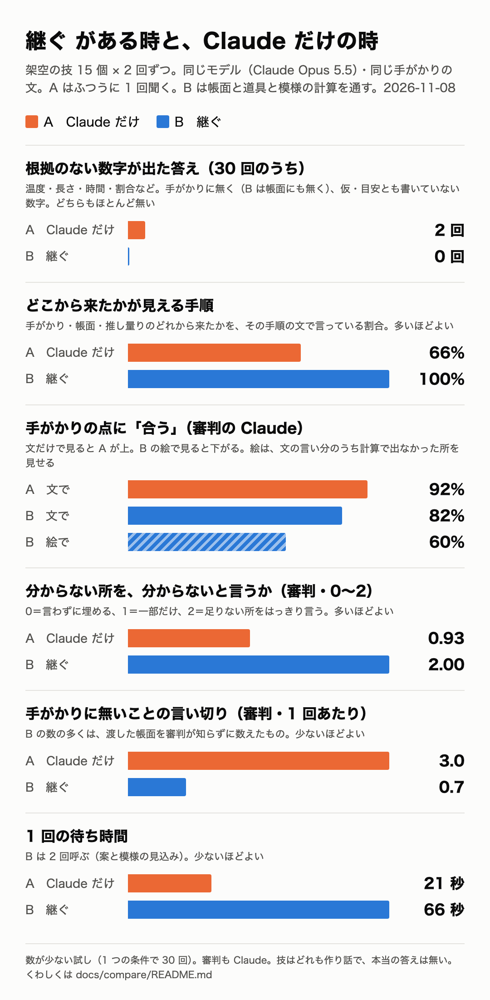

# 継ぐ がある時と、Claude にただ聞く時のちがい（2026-11-08）

作者の問い：「このソフトウェアがある場合と、なしで Claude がただ組み立てる場合の違いや、技法への到達度の差はある？」

今まで一度も測っていなかったので、測った。数は小さく、審判も Claude なので、ひとつの目安として読んでほしい。

## やったこと

- **技**：くせのある架空の技 13（`scripts/pattern-stress-cases.ts`。とても短い・長い・食いちがう・写真の見た目だけ・年寄りの言葉だけ・言葉のまちがい、漆と蝶番は「描かないのが正しい」技）と、見本の 2 つ（雨垂れ銀 `research/restore/sample-moyou.json`、輪打ち金筋 `sample-moyou-surface.json`）。あわせて 15。どれも作り話で、本当の答えは無い。
  - ダマスカス鋼の技（別の枝 w-lost で作っている所）は、測り終えた時にはまだ無かったので入れていない。
- **2 つの条件**。どちらも同じモデル（Claude Opus 5.5）・同じ設定（画面と同じ `api/claude.ts` の関数を通す）・同じ手がかりの文。
  - **A「Claude だけ」**：短いふつうの指示「金工の技の手がかりから、作り方の手順と、できる模様を答えてください。」と、手がかりの文だけ。道具・帳面・模様の計算は無い。手順と模様を文で答える。
  - **B「継ぐ」**：画面と同じ流れ。組み立て直しの指示と職人の帳面 → 案（`propose_restoration`）→ 模様の見込み（`predict_pattern`）→ 計算の絵。A と同じ手がかりだけにするため、試した結果は入れず、案 1 と見込み 1 だけ。
- それぞれの技を、条件ごとに 2 回ずつ（ばらつきを見るため）。あわせて 60 の答え。生の答えは全部 `raw/` にある（`<技>-A1.json`、`<技>-B1.json`、B の絵 `<技>-B1-top.png`・`-section.png`、審判 `<技>-judge-1.json`）。
- 作り直し方：`npx tsx scripts/compare-plain.ts run <.env のある所>` → `judge <.env のある所>` → `judge <.env のある所> --no-picture` → `score` → `chart`。

## 測ったもの

1. **根拠のない数字**：単位つきの数（温度・長さ・時間・割合・重さ・番手・年代）で、手がかりの文に無く、仮・目安とも書いていないもの。機械で数えた（`scanNumbers`）。B は、渡した職人の帳面にある数も「根拠あり」にした。A は帳面を見ていないので、帳面にたまたまある数でも根拠ありにしない（はじめは両方に帳面を当てていて、A の「0.5〜1 mm」が帳面の指輪の数と重なって見落とされた。手で見て直した）。枚数・回数・本数のような数のことばは、別に数えた（A・B どちらも 30 回で 20）。
2. **どこから来たかが見える手順**：手順の文の中で、手がかり（名前・番号・引用）・帳面・推し量り（「推測」「分からない」「もともと」など）のどれから来たかを言っているか。機械で数えた（`saysWhere`）。
3. **手がかりとの合い方**：手がかりの文を、確かめられる点（色・形・並び・裏・高さ など）に手で分けた（15 の技で 72 点）。別の Claude を審判にして、点ごとに「合う・一部・合わない」を見てもらった。どちらの条件かは書かず、並べる順はくじ。B は計算の絵（表と断面）も渡し、絵に見えることを重く見てもらった。A は絵が無いので文で見る。もう一度、B にも絵を渡さず文だけで見てもらった（`--no-picture`）。
4. **正直さ**：審判に、分からない所を分からないと言っているか（0〜2）、手がかりに無いことの言い切り、物の理屈として疑わしい言い分を挙げてもらった。漆と蝶番は「描かない」が正しい。
5. **時間と費用**：1 回の答えにかかった秒と、トークンからの費用（Claude Opus 5.5 の値段：入力 $4・出力 $20・キャッシュ読み $0.20・キャッシュ書き $5、100 万トークンあたり）。

## 結果（30 回ずつ）

|  | A　Claude だけ | B　継ぐ |
|---|---|---|
| 根拠のない数字が出た答え | 2 回（「約 780℃」「0.5〜1 mm」） | 0 回 |
| どこから来たかが見える手順 | 133 / 201（66%） | 276 / 276（100%） |
| 手がかりの点に合う（文で見る） | 92%（もう一度の文だけの審判では 94%） | 82% |
| 手がかりの点に合う（B は絵で見る） | — | 60%（一部 33%・合わない 7%） |
| 分からない所を分からないと言う（0〜2） | 0.93 | 2.00 |
| 手がかりに無いことの言い切り（1 回あたり） | 3.0 | 0.7（うち 0.5 は帳面。下を見て） |
| 物の理屈として疑わしい言い分（1 回あたり） | 0.7 | 0.8（多くは「絵が文と合わない」） |
| 漆・蝶番を描かずに理由を言う | —（文で答える問いなので、A は断る場が無い） | 4 / 4 |
| 1 回の待ち時間 | 21 秒（11〜44） | 66 秒（46〜96） |
| 1 回の費用 | 約 $0.03 | 約 $0.18 |
| 答えの長さ | 約 1,060 字 | 約 3,080 字 |

道具の入力を断った回数・こわれて止まった回数は、B で 0。審判の 60 回の費用は約 $4.2、A と B の答えは合わせて約 $6.3。

## 分かったこと

**数字のちがいは小さかった。** 予想とちがい、A も、温度や厚さをほとんど書かなかった（30 回で 2 回）。今のモデルは、ふつうに聞いても、数字はかなり控える。継ぐの「出典のない数字は作らない」の決まりは、数字よりも、次の 3 つで効いていた。

1. **分からない所を、工程ごとに言う。** B は 276 の工程のうち 275 に「分からない：何度か、どのくらいの時間か、試して決める」のような一言を書いた（審判の点 2.00）。A は、はじめに「推測です」と断るが、工程の中では、煮る液・道具・ろうの種類などを言い切って埋めることが多かった（0.93、言い切り 1 回あたり 3.0）。
2. **どこから来たかを、工程ごとに言う。** B は道具が根拠を書かせるので 100%。A も手がかりの番号を自分で引くことが多い（66%）が、根拠の話を手順の前の段にまとめて、手順そのものには書かないこともある（金の網目など）。
3. **絵が、文の言い分を確かめる。** これがいちばん大きいちがい。A の 92% は「文でそう言っている」だけで、確かめようがない。B も文だけなら 82% だが、計算の絵で見ると 60% に下がる。下がった所は、文では言えても、選んだ工程と数では、そうならなかった所。B はそれを絵で見せてしまう（下の例）。

## くらべた例

### 1. 木の葉金：文では言えるが、絵で見ると合わない（B の弱さが見える）

手がかりは「赤茶色の地に、白い輪で真ん中が赤い葉」。

- **A（2 回目）**：上の板を銅にして「赤茶色（銅）の地の上に…外側に白（銀）、その内側に赤（銅）」と書いた。層の順の考え方は筋が通っている。ただ、確かめる絵は無い。焼く所では「約 780℃で溶けはじめます」と、手がかりに無い温度を書いた（銀と銅がまざると低い温度で溶けるのは知られたことだが、継ぐの決まりでは書かない数字）。
- **B（1 回目）**：文では「外が白く真ん中が赤い葉」と書いたが、見込みで「いちばん上を銀」にしたので、絵は白っぽい銀の地に赤い葉だけ（`raw/konoha-B1-top.png`）。審判は 7 点のうち合う 1・一部 4・合わない 2。B の文の工程は「何枚重ねるか、いちばん上が銅か銀か、は分からない。試して決める」と正直だったが、見込みの選び方がまちがっていた。
- この例は、B が負けた例。でも、まちがいが絵に出たので、職人は試す前に気づける。A の文のまちがい（あれば）は、試すまで分からない。

### 2. 雨垂れ銀：計算が「その深さでは赤が出ない」と言う（B の強さ）

手がかりは「目の中に黒・白・赤の輪」「穴の深さと間は書かれていない」。

- **A（1 回目）**：「黒・白・赤の輪が同心円状に重なった模様になります」「穴が深いほど輪の数が増えます」と言い切った。職人の見立て（「変わるのではないか」）を、確かなことにしている。
- **B（1 回目）**：仮に深さを厚みの 4 割にして計算し、「仮に決めた浅い穴では銅に届かないので、赤い芯は出ないと見込まれます」と書いた。絵は黒い地に白い丸だけ（`raw/amadare-B1-top.png`）。審判は「肝心の赤が出ない」で、その点を「合わない」にした。点は下がるが、「赤を出すには、もっと深く穿つ」という、試して確かめられる見込みになっている。

### 3. 波打ち銅板：板の厚さ

- **A（1 回目）**：「薄めの銅板（0.5〜1mm ほど）を切り出し」。年寄りの話には厚さが無い。
- **B（1 回目）**：「板の厚さ、大きさ、銅の質は分からない。試して決める。」

### 4. 鉄地の黒漆金粉：描かない技

- **A**：漆の研ぎ出しの手順を、よくまとまった文で書いた（手がかりの点 5 つのうち 4〜5 が合う）。ただ「研ぐ物を炭や砥石」「上から黒い漆を塗って金粉をうめる」などは言い切り。
- **B**：2 回とも「金属を重ねる技でも、板の表を彫る・打つ・はめる技でもないので、この計算では表せません」と描かずに、案だけを出した。「塗る回数、1 回の厚さは分からない。試して決める」「湿り気で固めたか、熱で焼き付けたか分からない」。蝶番も 2 回とも描かなかった。

## A のほうがよかった所（公平に）

- **速くて安い**：待ち時間は 3 分の 1、費用は 5 分の 1 ほど。答えも短く、読みやすい（約 1,060 字と 3,080 字）。
- **手がかりに合っていると言い切れる点が多い**（文で 92〜94%）。絵が無いので、すべての点に「こうなる」と書ける。
- **本当の技の名前で言う**：布目象嵌・木目金・魚々子・四分一など、近い技の名前を挙げる。職人が調べる入口にはなる（ただし作り話の技を本物の技と決めつける言い切りにもなる。審判はそこを言い切りに数えた）。
- **手がかりを疑う力**：金の網目で「砂を吹きつけると傷はばらばらになり、網目にはならない」とメモの言葉を退けた。銀筋の小皿では、食いちがう手がかりを 3 つの道に分け、それぞれ合う点・合わない点と、確かめ方を書いた（B も 2 つの道を残した）。
- **層の順の考え方**：木の葉金では、A のほうが手がかりの「赤茶色の地」に合う順を選んだ。

## B（継ぐ）のほうがよかった所

- **分からない所を、工程ごとに、はっきり言う**（2.00 と 0.93）。「試して決める」までつく。
- **根拠が工程ごとに見える**（100%）。手がかりの名前、帳面の決まり、「もともとの知識から」のどれかが、どの工程にもつく。
- **手がかりに無いことを言い切らない**（帳面の分をのぞくと 1 回あたり 0.2、A は 3.0）。
- **絵で確かめられる**。文の言い分が、選んだ工程と仮の数で本当にそうなるかが、絵と断面で見える。合わないときは、合わないと分かる（例 1・2）。
- **表せないことを書く**。30 回とも「この絵では表せないこと」を挙げた（焼く温度・鋳る手順・網目の手ざわり など）。
- **描かない技を描かない**（漆・蝶番 4 / 4）。

## この試しの限り

- **数が少ない**：15 の技を 2 回ずつ。技によって答えが大きく変わる（木の葉金の B は、1 回目と 2 回目で合う点が 1 と 3）。差の小さい所（根拠のない数字、疑わしい言い分）は、偶然でも出る大きさ。
- **審判も Claude**（同じモデル）。どちらの条件かは書かなかったが、B は絵と根拠の書き方で、すぐ見分けがつく。審判の物差しが、B の書き方（「分からない」を言う）に寄っているかもしれない。
- **帳面の言い切り**：審判には手がかりだけを渡し、B に職人の帳面を渡したことは知らせなかった。それで、B の言い切り 20 のうち 15 は「手がかりに無い帳面を出典にした」だった。帳面は B が正しく受け取った資料なので、これは審判の側の数え方のくせ。表では両方を書いた。
- **絵がある方が不利**：A は文で何でも言える。B の 60% は「絵で見せられた所」だけを数えている。点を比べるときは、B の文だけの 82% と並べて見てほしい。
- **機械の数え方**：数字と根拠の言葉は、決めた言葉と単位で数えた。「一番」「一枚」のようなふつうの言葉を数字にしないようにしたが、取りこぼしや数えすぎはありうる。手で見たのは：数字の全部の当たり（A・B の量の数字 30 か所ほど）、A の手順の分け方（見出しの下の分かれ道で手順が切れていたのを直した）、審判の判断 4 つ（木の葉金 B1・雨垂れ銀 B1 の絵は、審判の言うとおり手がかりと合わない。蝶番 A2・漆 A1 の文の言い切りも、審判の言うとおり）。
- **作り話の技**：本当の答えが無いので、「技に届いたか」は測れない。測ったのは、手がかりとの合い方と、正直さだけ。
- **試した結果を入れていない**：継ぐの本当の強みの 1 つ（職人が試した結果で案を作り直す）は、この比べに入っていない。A と同じ材料で比べるため。
