# 審査する人の目で通す（2026-11-07 夜）

はじめて継ぐを見る審査の人のつもりで、公開と同じ組み立て（`npm run build` → `npx vite preview --port 5497`）を、ヘッドレスの Chromium で通した。毎回まっさらなブラウザ（覚えた物なし）。PC（1440 × 900）とスマホ（390 × 844）。

通した順：入口のページを上から下まで読み、リンクとボタンを全部たしかめる → README の「使い方」のとおりに、設計（生成・石なし・テンション・Claude に教える・決まりを外して比べる・手順・記録・見せる・図面）、帳面（決まりを足す・Claude から質問）、学ぶ（職人に聞く・手の動きを比べる）、技の頁 7 つ、途切れた技（例 3 つと模様の見込み）、模様の試し → 合言葉の入口。

手元の `vite preview` には `/api/claude` がないので、Claude を呼ぶ所は「つながらない」になる。合言葉の入口は `?gate` で開き、公開の版と同じ返事（違えば 401、合えば 400）を Playwright で返して試した。

## 見つからなかった物

- 画面のエラー（console の error）：どの頁も 0（ヘッドレスの WebGL の「GPU stall」の warning だけ。合言葉を違えたときの 401 は、わざと）。
- 横のはみ出し・壊れた画像：どの頁も 0。
- 入口のページの読み込み：0.2 秒。帳面・学ぶ・技は 0.2 秒以内に中身が出る。
- Claude なしの道：生成（今の案のまま）、学ぶ（帳面から職人の言葉つきで答える・帳面にない問いは職人に回す）、決まりを足す（言葉をそのまま案にして、直してから足せる）、Claude に教える（Claude なしで、数字で書く）、途切れた技の見込み（「合言葉が要ります」と出る）は、どれも行き止まりにならず、何が要るかを書いていた。

## 直した所

| | 前 | 後 |
| --- | --- | --- |
| 1. 途切れた技の頁の例のリンク 3 つが、1 つの文につながって見えた |  | 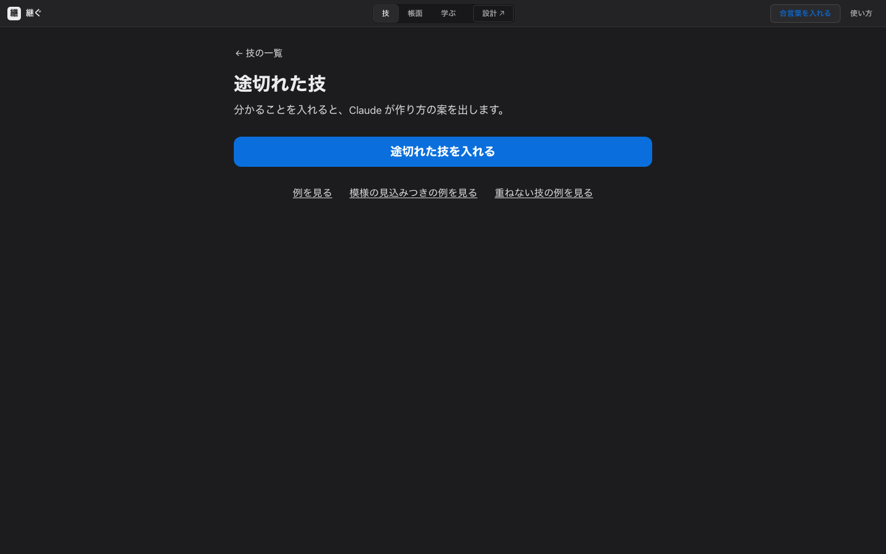 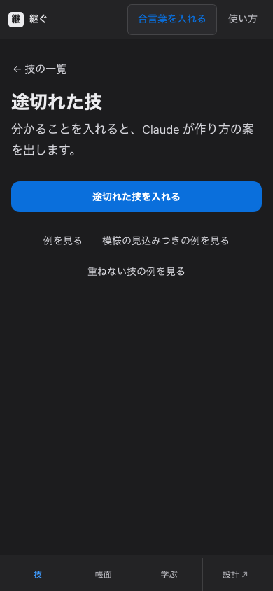 |
| 2. スマホで、合言葉なしに「生成」を押すと、説明が画面の下に隠れ、何も起きないように見えた。上に短く知らせる | 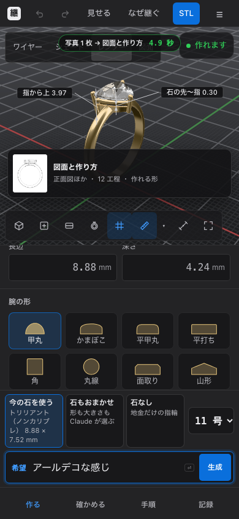 | 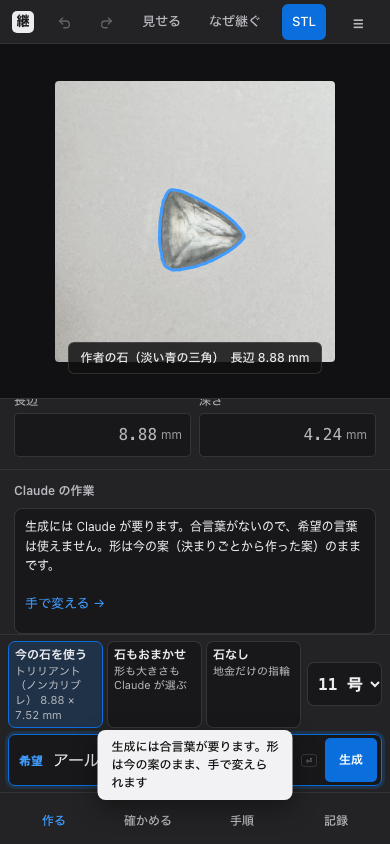 |
| 3. 入口の合言葉の窓が「はじめるには」だけで、何を開くのに要るのか分からない →「設計・帳面・学ぶ・技を開くには」 | 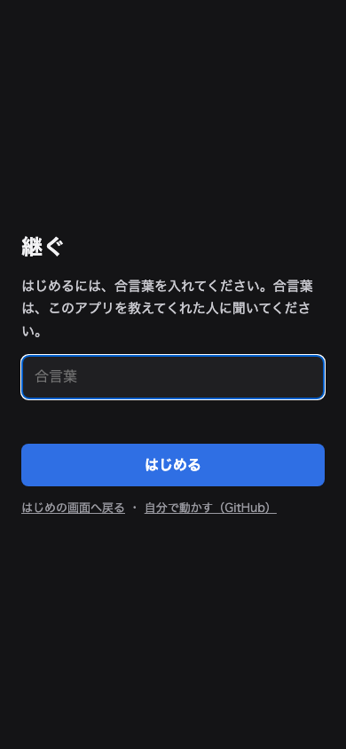 | 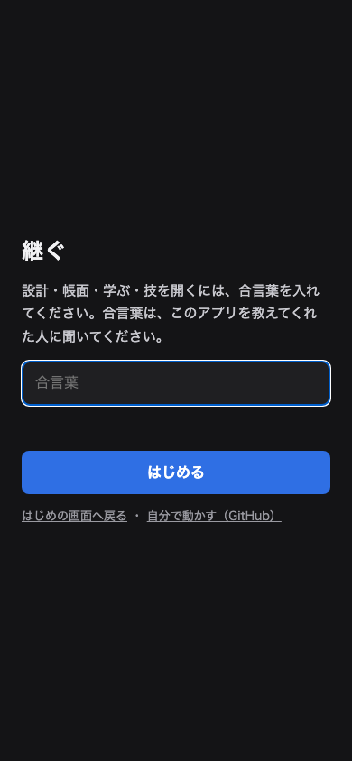 |
| 4. Claude に教えるの「いまの設計 石の大きさ 8.2 mm」。石は長辺 8.88 mm なので迷う → 長辺と幅の平均と書く | 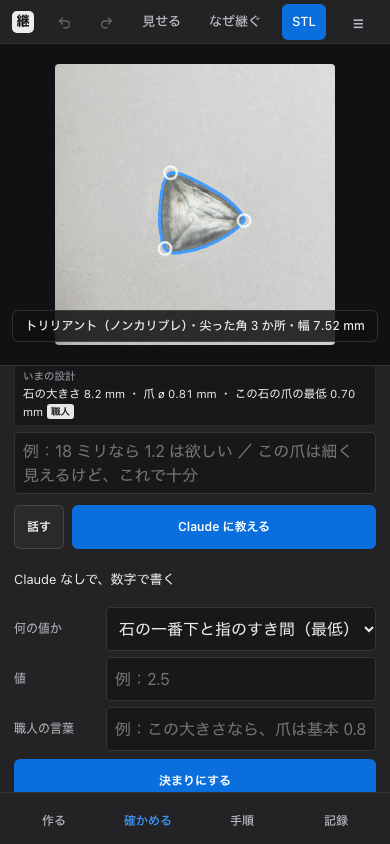 | 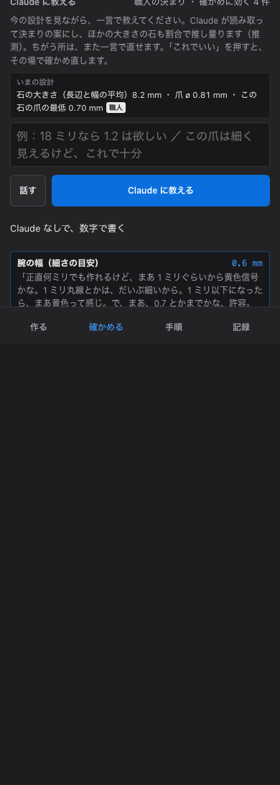 |
| 5. 入口のページは「11 のうち 9」、力試しを開くと「10 / 11」。どちらの回かを書き添える | 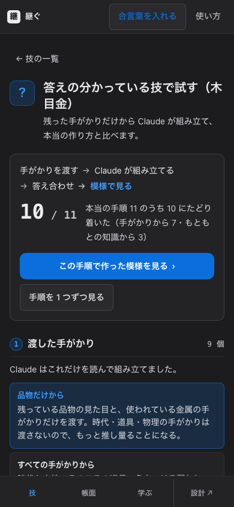 | 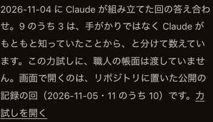 |
| 6. 入口のページの架空の技の「途切れた技の画面で例を見る」が、ほぼ空の一覧に着いた → 輪打ち金筋の見込みの頁へ直接 | （一覧は 1 の前の絵） | 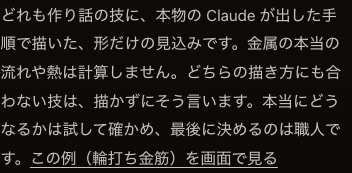 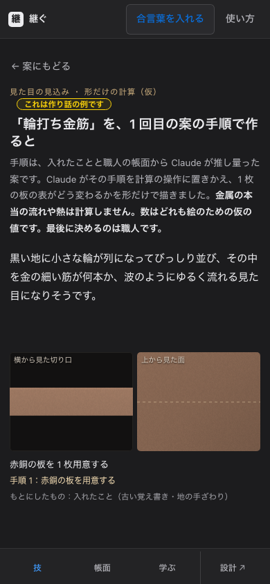 |
| 7. README と画面のちがい：タブは PC で上・スマホで下、並びは 技・帳面・学ぶ・設計／「方眼」→「目盛り」／模様の見込みの例 2 つは途切れた技の頁にある／`?mihon` も公開の版では入口で合言葉を聞く／学ぶは「Claude につながらなくても」帳面から答える | | |

## 残した所（審査の人が気づきやすい順）

1. **合言葉がないと、入口のページしか見られない。** 公開の版（`*.vercel.app`）では、設計・帳面・学ぶ・技も、作り話の見本（`?mihon`）も、はじめに合言葉の窓で止まる。中の「Claude なしでも動く所」は、合言葉のない人には届かない（2026-11-05 作者が決めた入口）。提出の文に合言葉を必ず書くこと。見本だけ合言葉なしで開くかは、作者が決める。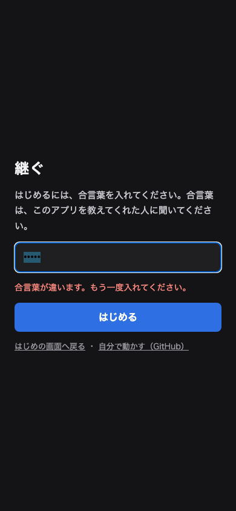
2. **設計を開いてから「作れます」まで、ヘッドレスで約 10 秒。** 写真 → 輪郭 → 角 → 指輪の見せる流れ（わざと）。欄はすぐ使えるが、待たされる感じはある。本物の GPU では短いはず（確かめていない）。
3. **模様の見込みの頁（別の係の `pattern-view`）**：段が 1 つずつ現れる作りなので、出る前は下に大きな空きがある（全体を撮ると目立つ）。触っていない。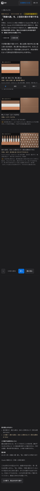
4. **テンションを選ぶと、最初は「長い辺を溝に」の向きで、黄色の「腕の幅の外へ大きく出る」。** 作者が作った指輪の向き（短い辺を溝に）を最初にするかは作者が決める。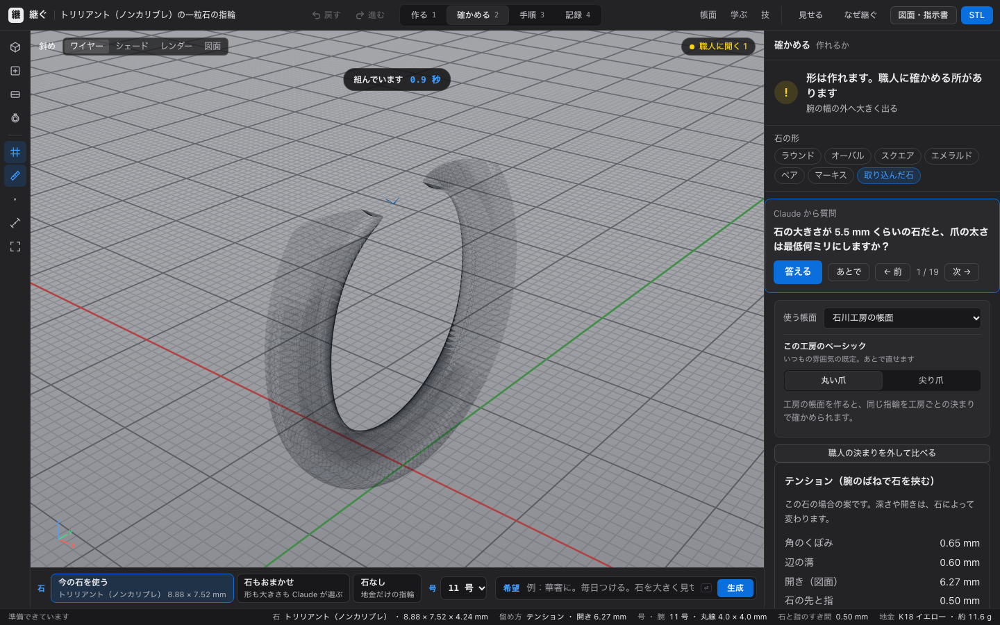
5. **「この工房のベーシック」の「この石で標準 ø 1.41 mm」**：石川工房の決まりで爪は 0.80 mm なので、何の標準か分かりにくい。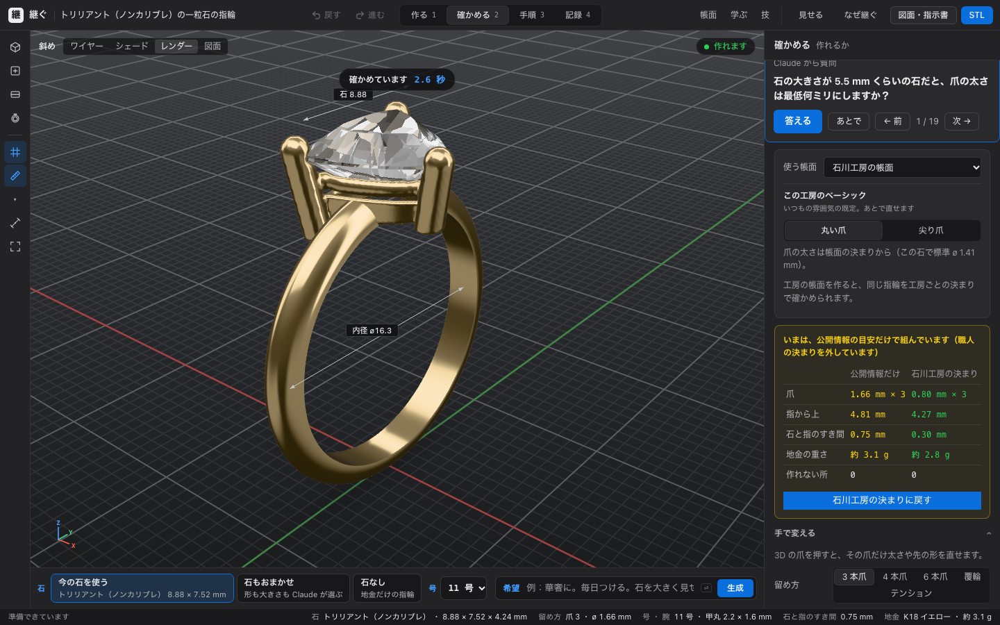
6. **答え合わせの頁の Claude の採点の文**が「10 のうち 9 つが合っている」と書き、上の「11 のうち 10」と数え方がちがう。本物の返事なので触っていない。
7. 小さな所：石なしで合言葉なしのとき、生成していないのに「生成の前に戻す」が出る（地金のみに切り替えた分を戻すボタン）。合言葉の窓は、頁を移っても開いたまま。スマホの短い知らせ（toast）は、希望の欄に少し重なる（3 秒で消える）。

## 確かめ

- `npx tsc --noEmit`：通った。
- `npm run build`：通った。
- `npx vitest run --testTimeout=180000 --maxWorkers=4`：99 ファイル・1571 件が通った（1 件は前から skip）。
